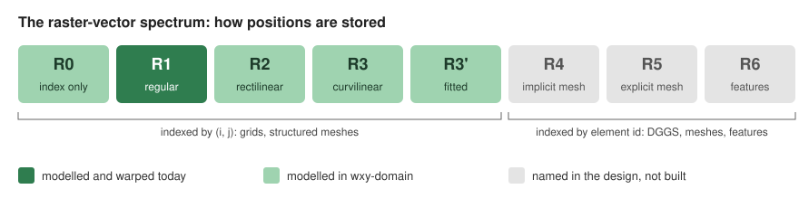

# wxylib/docs

The source of the wxylib site, **https://wxylib.org/docs/**: one
place for what wxylib is, what works, how-tos, explainers, the design
documents and how to help.

wxylib is an early-stage set of Rust crates that takes the modular ideas
inside GDAL (grids, georeferencing, chunked reads, warping, virtual
datasets), gives each one its own small home, and builds on existing
crates (async-tiff, zarrs, Icechunk, rwarp) rather than replacing them.
GDAL is the inspiration and, for now, the test oracle.



## Reading on GitHub

Every page is markdown and reads here too:

- [Start here](start.qmd): run `wxy` from a container or build it.
- Capability map: the data is [capabilities/capabilities.yml](capabilities/capabilities.yml);
  open the rendered site to view the page.
- [How-tos](vignettes/README.md), starting from the
  [OISST walk-through](oisst-virtual.md).
- [Explainers](explainers/index.qmd): how each ported GDAL mechanism works
  and how it is checked.
- [Gaps and contributing](contribute.qmd).
- [Design documents](https://github.com/wxylib/design).

## Building the site

The site is a [Quarto](https://quarto.org) website. The design documents
are pulled in from wxylib/design at build time, so they have one copy.

```sh
git clone https://github.com/wxylib/design   # into this directory, as design/
git clone https://github.com/wxylib/core     # optional, as core/: live counts on the capability map
python3 -m pip install pyyaml                # for capabilities/build.py
python3 capabilities/build.py                # once, before the first render
quarto preview
```

The capability map is generated from
[capabilities/capabilities.yml](capabilities/capabilities.yml) before each
render; a status change is a one-line edit there.

`.github/workflows/publish.yml` renders on every pull request and
publishes from main.

License: MIT OR Apache-2.0.
