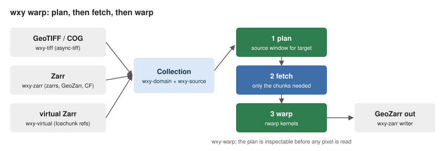

# wxylib

wxylib is an early-stage set of Rust crates that takes the modular ideas
inside GDAL (grids, georeferencing, chunked reads, warping, virtual
datasets), gives each one its own small home, and builds on existing crates
(async-tiff, zarrs, Icechunk, rwarp) rather than replacing them. GDAL is
the inspiration and, for now, the test oracle.

**Status:** pre-release and moving fast. Nothing is on crates.io yet, APIs
will change, and the design is still being decided one gated step at a
time. This repository will grow into the book (tutorials, examples,
explainers); for now it is this page.

## The idea in two pictures

Every dataset sits somewhere on one ladder, from a bare array to a table of
features, according to how its positions are stored. wxylib models the
ladder as one type rather than separate "raster", "multidimensional" and
"vector" modes.


Work is split into planning, reading and computing. A warp first plans
which part of the source the target needs, then fetches only those chunks,
then resamples. Any source that can present itself as a Collection of
chunks (GeoTIFF, Zarr, or virtual Zarr pointing into other files) goes
through the same pipeline.



## What works today

New here? The [OISST walk-through](oisst-virtual.md) reads a month of real
sea surface temperature from NOAA's bucket as virtual Zarr, checks it
against GDAL, and warps a day to the Antarctic.

All in [wxylib/core](https://github.com/wxylib/core):

| Crate | What it does |
|-------|--------------|
| `wxy-domain` | The data model: dims, domains, mappings (R0 to R3'), frames, cell conventions. No I/O. |
| `wxy-source` | Chunk sources: plan, fetch, decode, with chunking in index space. |
| `wxy-tiff` | GeoTIFF and COG reads through async-tiff. |
| `wxy-zarr` | Zarr v3 reads through zarrs, georeferenced by GeoZarr `spatial:`/`proj:` or CF coordinates; writes GeoZarr grids. |
| `wxy-geozarr` | The GeoZarr `spatial:` and `proj:` conventions on their own, usable by any Zarr tool. |
| `wxy-virtual` | Virtual Zarr: tiled TIFF byte ranges, or a byte-reference table (mdim-refs, such as a netCDF archive scanned by GDAL), as Icechunk virtual references to local files or `https://` URLs, read back as Zarr. |
| `wxy-resample` | GDAL's warp kernels (nearest, bilinear, cubic), in GDAL's arithmetic order, scaled when the target is coarser. |
| `wxy-warp` | Warp onto a target grid: GDAL's chunked warp with `wxy-resample` kernels, or one pass through [rwarp](https://github.com/hypertidy/rwarp). Regular, rectilinear and curvilinear (2D lon/lat) sources; extra dimensions such as time and depth streamed slice by slice under one plan; overviews chosen as `gdalwarp -ovr AUTO` does. Also reads values at points and the cells under polygons, fetching each chunk once. |
| `wxy-cli` | The `wxy` command: `wxy warp` (GeoTIFF or Zarr in, GeoZarr out), `wxy points` (values at points, CSV) and `wxy zonal` (statistics over GeoJSON polygons, CSV). |

Known gaps: fitted (R3') grids and meshes do not warp yet; netCDF is read
only through a byte-reference table, not directly; `wxy-virtual` does not
yet handle LZW or predictors, `s3://` references, or tables with several
chunks per file; CRS work uses the pure-Rust proj4rs backend (EPSG codes,
no datum grids; see [CRS input](crs-input.md) for which strings work where,
and how they map to Rust Geodesy pipelines). The Python and R packages are
early spikes that warp in-memory arrays only; nothing is published.

## Examples

- [Zonal statistics by lazy rasterization](examples/zonal/README.md):
  `wxy zonal` against GDAL's dense rasterize and exactextract, with
  timings and peak memory.

## Explainers

How each GDAL mechanism that wxylib ports works, in GDAL and in wxylib,
and how the two are checked against each other.

- [How the warper works](explainers/warper.md): chunks, source windows
  and kernel scale, and why they change the values a warp writes.

## What the tests check

The tests use GDAL as an oracle. Small synthetic files and GDAL's output for
them live in [wxylib/fixtures](https://github.com/wxylib/fixtures), made by
scripts there with GDAL (through rasterio) and zarr-python.

- **Reads** (`wxy-tiff`, `wxy-zarr`, `wxy-virtual`): every window must match
  what GDAL reads, byte for byte, across five GeoTIFFs (int16, uint8,
  uint16, float32; DEFLATE, ZSTD, LZW with predictor; COG and plain; pixel
  and band interleaved; BigTIFF), three of them converted to Zarr, and a
  byte-reference table over three netCDF4 files (one chunk missing on
  purpose, which must read as fill).
- **Warps** (`wxy-warp`, `wxy-cli`): three source/target pairs (global to
  Antarctic polar stereographic, polar to lon/lat, UTM to lon/lat) with
  nearest, bilinear and cubic, at 1:1 and coarser, compared with what
  GDAL's warper writes; curvilinear swaths placed by cell centres or
  corners, against GDAL's geolocation-array warp; and an OISST-style 4D
  store as xarray writes it, day by day.
- **Extraction** (`wxy-warp`): values at random points, by cell and
  interpolated, against GDAL's point reads; and the cells under random
  polygons with holes, by cell centre and all-touched, against GDAL's
  rasterizer.
- **Model** (`wxy-domain`, `wxy-geozarr`): unit tests, including real-world
  grid cases from regular-in-what (a float32 GHRSST axis, AVISO's Mercator
  latitude, NSIDC polar stereographic).

The bar is identity: every warp, point read and polygon case must give
GDAL's numbers exactly, cell for cell.

CI runs `cargo test --workspace` against the fixtures on every push and pull
request to core.

## Try it

```sh
git clone https://github.com/wxylib/core
git clone https://github.com/wxylib/fixtures
cd core
cargo test --workspace
cargo run -p wxy-cli -- warp ../fixtures/cog/world-int16-deflate.tif out.zarr \
  --crs EPSG:3031 --extent -4e6 -4e6 4e6 4e6 --size 145 145
```

The tests find the fixtures at `../fixtures` (or `WXY_FIXTURES`) and skip
when they are missing.

## Getting involved

- **Read the design first.** [wxylib/design](https://github.com/wxylib/design)
  holds the module survey, the data model, the architecture and staged
  roadmap, and a survey of related work. Each step ends in a gate, so the
  open questions are written down there.
- **Open an issue** on the repository it concerns: a bug or a GDAL mismatch
  in core, a missing case in fixtures, a design question in design.
- **Contribute a fixture.** A small file plus the GDAL output it should
  produce is the most useful way to pin a behaviour down.
- **Prefer upstream.** If a fix belongs in async-tiff, zarrs, Icechunk,
  rwarp or the GeoZarr conventions, it goes there; wxylib keeps only what
  has no other home.

| Repository | Holds |
|------------|-------|
| [design](https://github.com/wxylib/design) | Design documents, roadmap and decisions |
| [core](https://github.com/wxylib/core) | The Cargo workspace |
| [fixtures](https://github.com/wxylib/fixtures) | Test files and GDAL oracle outputs |
| [docs](https://github.com/wxylib/docs) | This page, and later the book |
| [py](https://github.com/wxylib/py), [r](https://github.com/wxylib/r) | Early Python and R bindings (in-memory warp) |
| [web](https://github.com/wxylib/web) | Placeholder for a browser app |

License: MIT OR Apache-2.0.
