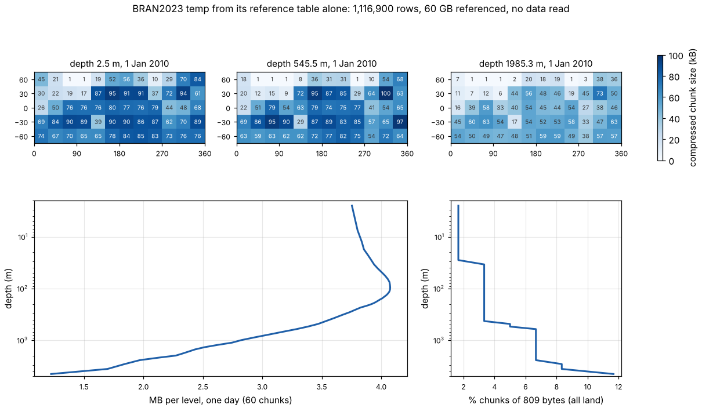
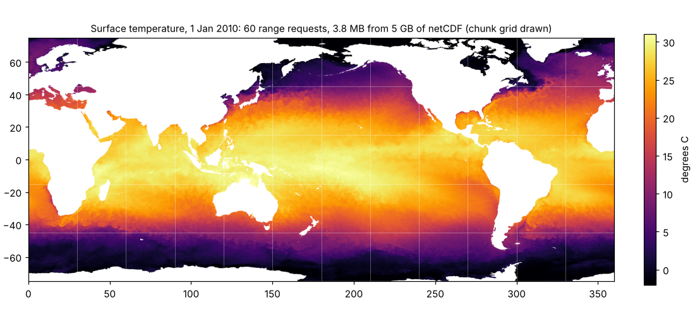
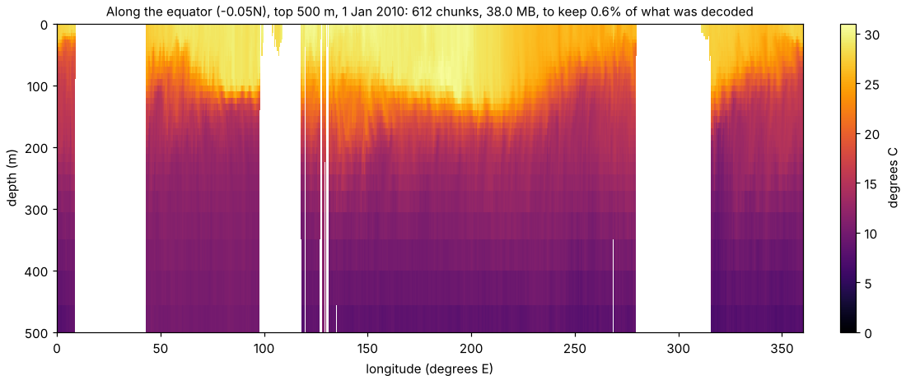
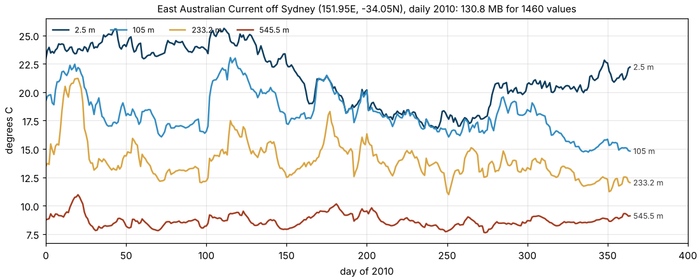

# A year of ocean reanalysis through its byte table

BRAN2023 (CSIRO Bluelink) is a global ocean reanalysis at 0.1 degree, 51
depth levels, daily. A year of its potential temperature, `temp`, is
twelve netCDF4 files on NCI's THREDDS server, about 60 GB, each chunk
300 x 300 cells of one day and one depth, int16, shuffled and deflated.

A *reference store* describes that year without copying it. It holds four
views of one set of byte ranges:

| View | What it is | Who reads it |
|---|---|---|
| `mdim.vrt` | a GDAL multidimensional mosaic VRT: the plan, file by file | GDAL |
| `flat/` | the mdim-refs table: `arrays.json` plus `refs_temp.parquet`, one row per chunk (`path`, `offset`, `size`), and `sources.parquet` | wxy, DuckDB, Arrow, anything that reads Parquet |
| `kerchunk/` | the same rows as a kerchunk Parquet reference store | fsspec and xarray, wxy |
| `icechunk/` | an Icechunk repository of virtual chunks | Icechunk and xarray, wxy |

wxy reads the flat, kerchunk and Icechunk views and gets the same bytes
as GDAL reading the VRT (the BRAN row of
[commit-criteria.md](https://github.com/wxylib/design/blob/main/docs/commit-criteria.md)).
This page exercises the store from the other side: what the table alone
says, and what three shapes of read cost.

The store's location is a parameter (`BRAN_STORE`). Today it is a
temporary keyed bucket, `s3://aadc-transfer/michae_sum/e2e/bran2023-daily-temp`
on the AAD transfer endpoint (`AWS_S3_ENDPOINT=transfer.data.aad.gov.au`,
`AWS_VIRTUAL_HOSTING=NO`, a read key in `AWS_*`); a public copy is
expected to replace it.

## The reader is one short file

[`bran_table.py`](bran_table.py) reads the store with no netCDF, HDF5,
Zarr or GDAL library: Parquet for the table, then for each chunk one HTTP
range request to `path` at `offset` for `size` bytes, `zlib`, and a
two-byte unshuffle. Run as a script, it reads the two windows wxy and GDAL
were compared on and prints their SHA-256:

```
chunk-t0-z0-y4-x0  d521d3e25758e62408faaa4076c1b2c759cad64b7240148122feb00adc728f65
row-tlast-z10-y750 9321b226f15218495f3a2da02d73b2a58a11c44a330186212a6d37fb786b940c
```

Both equal the hashes from `wxy` (`cargo run --release -p wxy-virtual
--example bran_refs -- $BRAN_STORE/flat --direct`) and from GDAL reading
`mdim.vrt` (fixtures `scripts/oracle_bran2023_store.py`). Three readers in
three languages, one set of bytes.

The figures come from [`make_figures.py`](make_figures.py).

## 1. The table is a map

Before any data is read, the table already describes the ocean. A chunk
that is all land is all fill value, and compresses to 809 bytes; a chunk
of open ocean with fronts and eddies compresses worst.



- At the surface, 1 of 60 chunks is all land; by 2 km
  it is 4 of 60, and 7 of 60 at the deepest level.
- Bytes per level peak near 100 m, where the thermocline is busiest,
  and fall by about 70% to the bottom. A day is 163 to 174 MB across all
  levels: the year is flat in bytes.
- The size of a chunk is a free summary of its content: a planner can
  skip land, and a reader can show where the information is before
  fetching any of it.

## 2. One day's global surface: 60 requests



The whole globe at full resolution for one day and depth is 60 chunks,
3.8 MB fetched in about 7 s from a cloud machine in another hemisphere.
The file it comes from is 5.3 GB.

## 3. A section: 612 requests for one row each



Along the equator at every depth is 51 x 12 chunks. Each is fetched and
decoded whole to keep one row of 300: 38 MB, about 48 s, to keep 0.6%
of what was decoded. This is the shape the chunking does not serve, and
the table says so before the read starts (`size` summed over the rows a
plan touches). Sections, profiles and moorings want a different chunking
or a rechunked copy; the table is where that choice is measured.

## 4. A year at one place: 365 requests per depth



A year of daily values at one cell is one chunk per day: 1,460 chunks,
131 MB, about 130 s for four depths, to keep 1,460 numbers. The eddies of
the East Australian Current show at every depth: warm-core events lift
the 233 m series by up to 8 degrees for weeks at a time.

## The same through `wxy`

`wxy` takes the store as a source wherever it takes a COG or Zarr. A
`--dry-run` plans without reading. For the whole year warped to a south
polar stereographic grid:

```sh
AWS_S3_ENDPOINT=transfer.data.aad.gov.au AWS_VIRTUAL_HOSTING=NO \
wxy warp $BRAN_STORE/flat polar.zarr --source-array /temp \
  --crs EPSG:3031 --extent -4e6 -4e6 4e6 4e6 --size 800 800 --dry-run
```

The plan fetches 446,760 of the 1,116,900 chunks (the two southern chunk
rows, every day and depth: 18,615 slices), which the table says are
30.3 GB stored. The plan's `stored_bytes` is not yet filled in for a
byte-reference table, though the table holds every size; that, and
choosing a subset of the leading dimensions (one day, a few depths) on
the command line, are the two gaps this exercise found.

## In the browser

The [BRAN2023 page](https://wxylib.org/web/bran.html) does exercises 2
and 4 in plain JavaScript: a cut of the table (four depths, every day),
range requests straight to THREDDS (which answers them with CORS), and
`DecompressionStream` for the inflate. Step through days and depths;
click for a year at one place. `?at=152,-34` opens the series above.

## What the numbers say

- A table of 6.5 MB (1.1 million rows) is enough to address 60 GB in
  place, from any language with Parquet and HTTP.
- THREDDS served about 1 MB/s to one client with 16 requests in flight.
  Map-shaped reads are interactive; time series and sections are minutes
  per year. A cache of fetched chunks (wxy-cache) makes the second look
  free; a rechunked or summarised product is the answer for routine
  time-series use.
- The chunk sizes are data in their own right: land masks, information
  density with depth, and a cost model for any plan.
