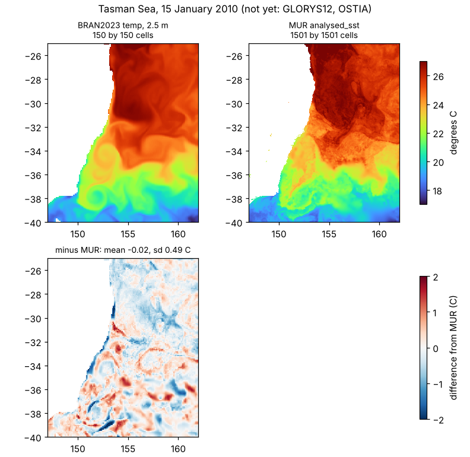
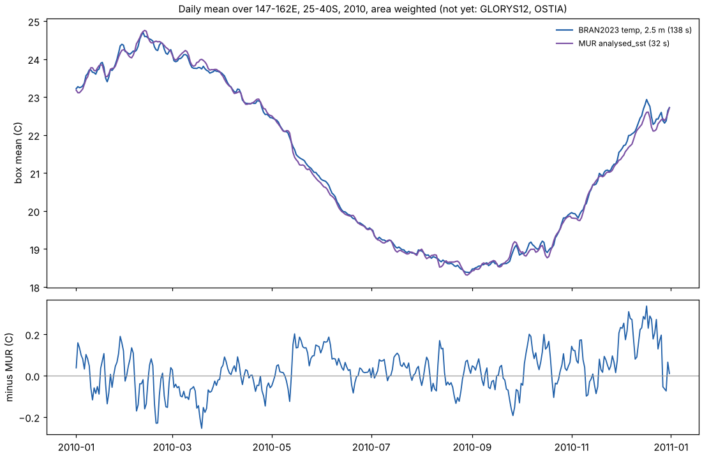
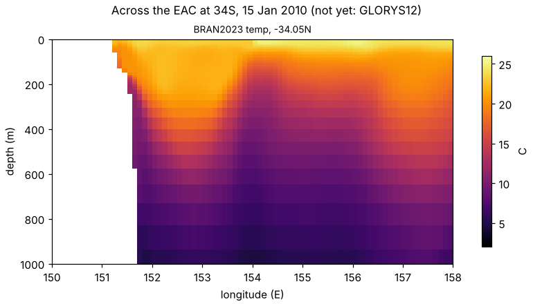

# Four estimates of one sea: Copernicus Marine Zarr beside BRAN and MUR

*Draft. The BRAN2023 and MUR parts below are measured; the Copernicus
Marine parts are written and wait on network access to their store.*

The Tasman Sea, where the East Australian Current sheds its eddies, is
estimated daily by at least four public products, each served in a
different shape:

| Product | What it is | Served as | Read here by |
|---|---|---|---|
| BRAN2023 `temp` | CSIRO Bluelink ocean reanalysis, 0.1 degree, 51 levels | netCDF4 on NCI THREDDS, addressed by an mdim-refs byte table | [`../bran/bran_table.py`](../bran/bran_table.py): Parquet, range requests, zlib |
| GHRSST MUR v4.1 `analysed_sst` | JPL foundation SST analysis, 0.01 degree | daily COGs on source.coop (ZSTD, horizontal predictor) | osgeo.gdal over `/vsicurl/` |
| GLORYS12 `thetao`, `so` | Copernicus Marine global physics reanalysis, 1/12 degree, 50 levels (`GLOBAL_MULTIYEAR_PHY_001_030`) | ARCO Zarr v2, `timeChunked.zarr` | osgeo.gdal multidim on `ZARR:"/vsicurl/..."`; wxy |
| OSTIA `analysed_sst` | Met Office SST reanalysis, 0.05 degree (`SST_GLO_SST_L4_REP_OBSERVATIONS_010_011`) | ARCO Zarr v2, `timeChunked.zarr` | as GLORYS12 |

The region is 147-162E, 40-25S, and the year 2010 (the year the BRAN
reference store holds). The same box is a region of the MUR regional
daily series, so the two pages share one MUR curve.

## Copernicus Marine ARCO stores

Copernicus Marine serves each dataset twice as Zarr v2 with consolidated
metadata, in buckets on an S3-compatible endpoint that refuse listing:

- `https://s3.waw3-1.cloudferro.com/mdl-arco-time-NNN/arco/PRODUCT/DATASET_VERSION/timeChunked.zarr`,
  chunked for maps (one time step, a large spatial block);
- `.../mdl-arco-geo-NNN/.../geoChunked.zarr`, chunked for time series
  (many time steps, a small spatial block).

The bucket number varies by dataset. The catalogue of URLs here comes from
the R package [cmemsarco](https://github.com/hypertidy/cmemsarco), which
builds it from the Copernicus Marine STAC catalogue and also gives the
GDAL source string for each store. Nothing needs to list the bucket: GDAL,
zarr-python and wxy all go from the root URL to `.zmetadata` and then to
chunk keys by the Zarr spec.

wxy reads such a store by URL (`wxy_zarr::open_url`), and `wxy warp`,
`points` and `zonal` take the URL as their source. A window check against
GDAL, as for the BRAN and MUR stores:

```sh
# GDAL's hashes of two windows (wxylib/fixtures)
python scripts/oracle_zarr_windows.py $GLORYS thetao glorys-thetao.json
# wxy's, compared (wxylib/core)
cargo run --release -p wxy-zarr --example zarr_windows -- $GLORYS \
  --manifest glorys-thetao.json
```

On a local Zarr v2 store written by xarray in the ARCO layout (blosc,
NaN fill, consolidated, served over HTTP) both windows are identical to
GDAL's. Two gaps showed up getting there, both closed: wxy ignored the
`_ARRAY_DIMENSIONS` attribute that names the dimensions of a Zarr v2
array, so it found no longitude or latitude to place the array by, and it
had no way to open a Zarr hierarchy by URL.

## Running it

```sh
python fetch.py            # cuts the box from each product into work/
python make_figures.py     # the figures below, from work/ alone
```

[`products.py`](products.py) holds one reader per product, each returning
values, longitude and latitude (and depth) for a box and a day;
[`fetch.py`](fetch.py) takes the cuts (`python fetch.py bran mur` for
some of them). BRAN needs the store's read settings, as in
[the BRAN example](../bran/README.md).

## 1. One day



BRAN's top level (2.5 m) and MUR's foundation temperature agree to
-0.02 C over the box, with a spread of 0.49 C. The differences are
eddy-shaped: a reanalysis places the EAC's eddies close to where the
observations put them, not exactly there, and an eddy displaced by a few
tens of kilometres leaves a dipole of plus and minus a degree or two.
MUR's 0.01 degree grid shows filaments that a 0.1 degree model cannot
hold.

Cost: BRAN, 2 chunks (125 kB) in 8 s; MUR, the full-resolution
1501 x 1501 window in 1.6 s.

## 2. A year of the box mean



The box-mean BRAN and MUR curves differ by 0.03 C on average, with a
day-to-day spread of 0.10 C, and by up to 0.3 C in early summer. A likely part of that is a
shallow warm layer, which a 2.5 m model level can see and a foundation
temperature (defined to be free of the daily warm layer) does not; the
OSTIA and GLORYS12 curves will show whether it is the models or MUR. Each mean is
cos(latitude) weighted over that product's own ocean cells, so the coasts
differ slightly.

Cost: BRAN, 730 chunks (46 MB) in 138 s from THREDDS; MUR, 365 reads at
0.1 degree, which GDAL serves from each COG's overviews, in 32 s.

## 3. A section across the current



At 34S, in BRAN, a warm core sits off the shelf near 152.5E, its
isotherms pushed down to 400 m and more, and they rise again to the east
near 154E: the EAC and its eddies in one slice. BRAN's section is 40
levels of 2 chunks each (3.6 MB) for 80 columns of one row, in 5 s. The GLORYS12 panels add salinity, the second
variable of the comparison: the BRAN reference store holds temperature
only.

## Still to run

- GLORYS12 and OSTIA cuts (`python fetch.py glorys ostia`), once the
  Copernicus Marine endpoint is reachable from where this runs, and the
  GDAL/wxy window check on the live GLORYS12 store.
- The same reads through xarray: `xarray.open_zarr` on the ARCO URL, and
  GDAL's xarray backend on the same `ZARR:` source string.
- Sea surface height (GLORYS12 `zos`) and the geoChunked stores for the
  point time series, where their chunking is the point.
