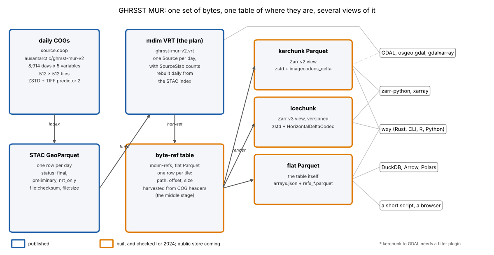
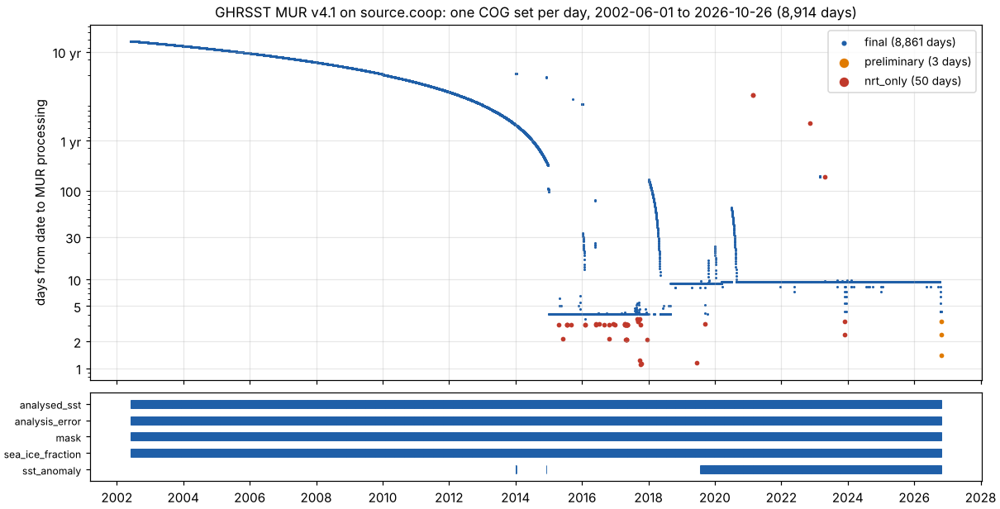
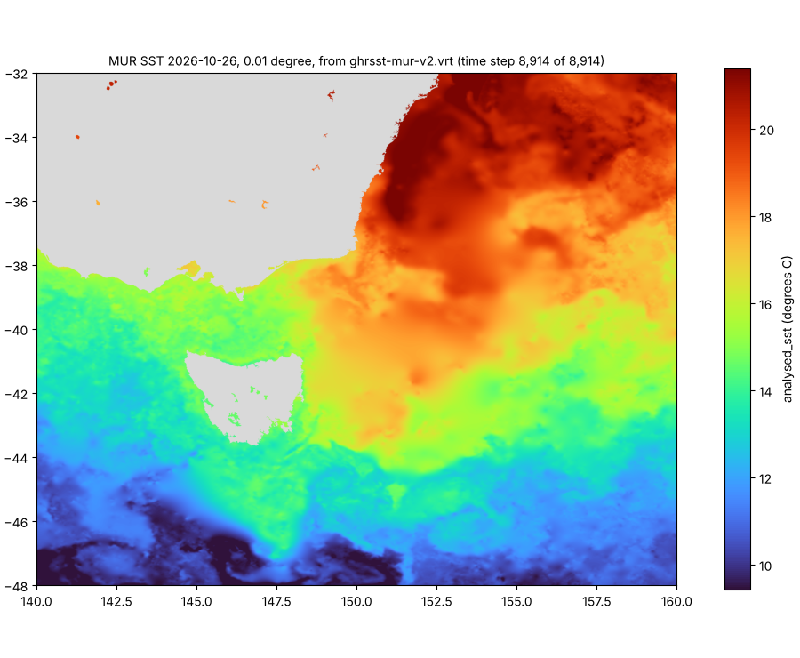
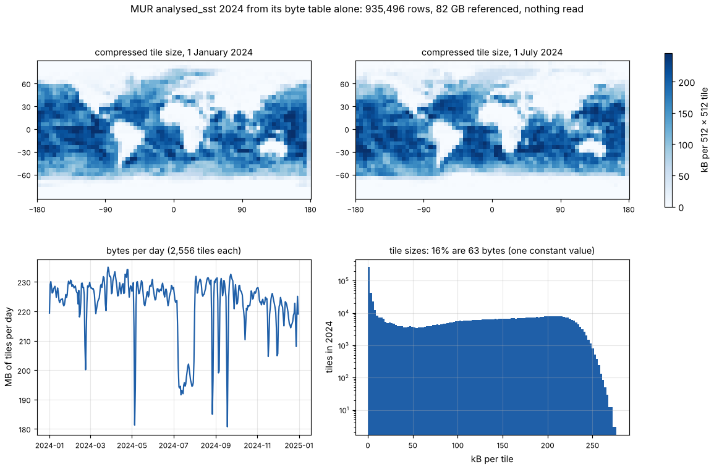
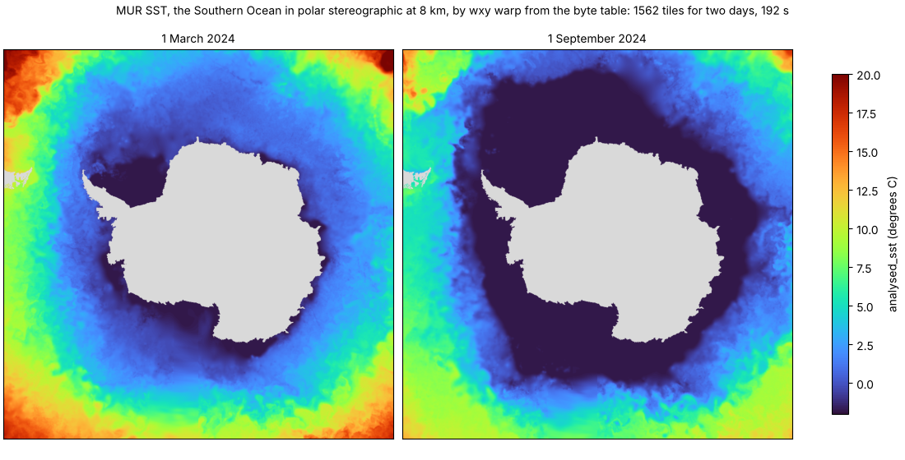
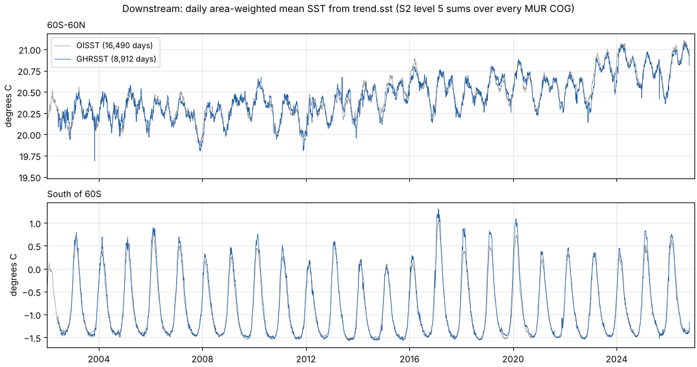

# Twenty-four years of sea surface temperature, one set of bytes

GHRSST MUR v4.1 is NASA JPL's daily global foundation sea surface
temperature analysis on a 0.01 degree grid, from 2002-06-01 to the present.
The [ghrsst-cogger](https://github.com/AustralianAntarcticDivision/ghrsst-cogger)
pipeline keeps every day of it on Source Cooperative as Cloud Optimized
GeoTIFFs (`ausantarctic/ghrsst-mur-v2`): five variables a day, each a
17999 x 36000 COG in 512 x 512 tiles, ZSTD with the TIFF horizontal
predictor, with a STAC GeoParquet index of every day and a GDAL
multidimensional VRT of the whole series. Its
[documentation](https://australianantarcticdivision.github.io/ghrsst-cogger/)
covers using the COGs from Python, R, GDAL, DuckDB and the browser.

This page uses the archive for something else: to show one set of bytes
read by every kind of reader the stack has. The bytes stay where they are.
What is published beside them is a table of where each tile is, and a set
of *projections* of that table, one for each family of reader.



| View | What it is | Read by | Status |
|---|---|---|---|
| COGs + STAC GeoParquet | the bytes, and one row per day | anything that reads a GeoTIFF | published |
| `ghrsst-mur-v2.vrt` | a GDAL multidimensional VRT: one `Source` per day, the plan | GDAL, osgeo.gdal, gdalxarray | published, rebuilt daily |
| flat byte table | mdim-refs: `arrays.json` plus one Parquet row per tile (`path`, `offset`, `size`) | wxy, DuckDB, Arrow, a short script | built and checked for 2024; [coming](#coming) |
| kerchunk Parquet | the table as a Zarr v2 store | zarr-python and xarray, wxy, GDAL with a filter plugin | built and checked for 2024; [coming](#coming) |
| Icechunk | the table as a versioned Zarr v3 store | Icechunk with zarr-python and xarray, wxy | built and checked for 2024; [coming](#coming) |

The scripts beside this page make every figure and number here:
[`make_archive.py`](make_archive.py), [`read_vrt.py`](read_vrt.py),
[`mur_table.py`](mur_table.py), [`make_bytemap.py`](make_bytemap.py),
[`make_polar.py`](make_polar.py), [`make_views.py`](make_views.py) and
[`make_downstream.py`](make_downstream.py). How a tile's bytes become
values, and how each view names the two codec steps, is the subject of the
explainer [COG tiles as Zarr chunks](../../explainers/cog-tiles.md).

## 1. The archive from its index

The STAC GeoParquet index (`ghrsst-mur-v2.parquet`, 0.6 MB) holds one row
per day. Read alone, it already describes the archive:



- 8,914 days to 2026-10-26, with no gaps. 8,861 are `final`, 50 are
  `nrt_only` (the final analysis never replaced the near-real-time one)
  and 3, the newest, are `preliminary`.
- The processing date shows MUR's own history: everything to 2014 was
  reprocessed in 2015; finals came about 4 days after the date until
  2018, and about 9 days after since.
- `sst_anomaly` exists for 2,664 days: nine days in January 2014, two in
  December 2014, then every day from 2019-07-23. The VRT reads the days
  without it as nodata.

## 2. GDAL reads the published VRT

The VRT is the one view a GDAL user needs nothing else for:

```python
from osgeo import gdal
gdal.UseExceptions()
gdal.SetConfigOption("GDAL_DISABLE_READDIR_ON_OPEN", "EMPTY_DIR")
ds = gdal.OpenEx("/vsicurl/https://data.source.coop/ausantarctic/ghrsst-mur-v2/ghrsst-mur-v2.vrt",
                 gdal.OF_MULTIDIM_RASTER)
sst = ds.GetRootGroup().OpenMDArray("analysed_sst")   # (time, y, x)
last = sst.GetDimensions()[0].GetSize() - 1
# 48S to 32S, 140E to 160E on the latest day, in degrees C
tas = sst.GetUnscaled().ReadAsArray(array_start_idx=[last, 12199, 31999],
                                    count=[1, 1600, 2000])
```



Opening the 16.6 MB VRT and reading its coordinates took 0.4 s; the
1600 x 2000 window of the latest day, 20 tiles of one COG, took 1.4 s.
Every `Source` carries a `SourceSlab` count, so a read opens only the
days it touches (the [multidimensional VRT explainer](../../explainers/mdim-vrt.md)
says why that matters). The five windows of the 2024 manifest, read at
the VRT's time offset for 2024-01-01 (7,884), have the SHA-256 that GDAL
gives on the COGs.

The same VRT opens in xarray through GDAL with
[gdalxarray](https://github.com/hypertidy/gdalxarray):

```python
import xarray as xr
ds = xr.open_dataset("/vsicurl/https://data.source.coop/ausantarctic/ghrsst-mur-v2/ghrsst-mur-v2.vrt",
                     engine="gdalxarray")
```

What the VRT cannot do is avoid opening a COG for each day it reads. A
year of daily values at one place (44S 150E, 2024) is one value from each
of 366 files, and through the VRT each file's header is fetched first:
**186 s**. The same 366 values from the byte table below are 366 range
requests of one tile each, 61 MB: **13 s**. Both give identical values.

## 3. The byte table is a map

The 2024 test build of the table has one row per tile: 935,496 rows for
366 days of `analysed_sst`, addressing 82 GB of tiles. Like the
[BRAN2023 table](../bran/README.md), it says a lot before anything is read:



- Tiles over fronts and eddies compress worst, up to 277 kB. The western
  boundary currents and the Southern Ocean fronts stand out on any day.
- 16% of tiles are 63 bytes: one constant value throughout, all land as
  fill, or all -1.8 degrees C under sea ice. The winter sea ice shows as
  a wider pale ring around Antarctica in the July panel.
- A day is 181 to 235 MB of tiles. The table prices any read (the sum of
  `size` over the rows it touches) before it is made.

## 4. Readers of the table: one set of bytes

The 2024 manifest ([`manifest.json`](manifest.json)) records GDAL's
SHA-256 of five windows of `analysed_sst` read from the COGs: a first
tile, a tile on the last day, a full row, a padded edge tile, and ten
days around Hobart. Each reader below reads the same windows from a view
of the table and compares:

| Reader | View | Windows identical to GDAL |
|---|---|---|
| GDAL 3.13.3, osgeo.gdal | `ghrsst-mur-v2.vrt` (published) | 5 of 5 |
| [`mur_table.py`](mur_table.py): Parquet, `urllib`, ZSTD and a running sum, about 100 lines | flat table | 5 of 5 |
| zarr-python 3 through xarray (`engine="kerchunk"`, imagecodecs registered) | kerchunk Parquet | 5 of 5 |
| zarr-python 3 with Icechunk | Icechunk | 5 of 5 |
| wxy (`refs_windows` example, `--direct` and through Icechunk) | flat, kerchunk, Icechunk | 5 of 5 |
| GDAL's Zarr driver with an `imagecodecs_delta` filter plugin | kerchunk Parquet | 5 of 5 |

Without the plugin GDAL stops at "Filter imagecodecs_delta not handled";
the [explainer](../../explainers/cog-tiles.md) has why. The script reader
is the clearest statement of what the table promises:

```sh
MUR_STORE=ghrsst-mur-v2-20240101-20241231/out python3 mur_table.py manifest.json
```

```
chunk-t0-y0-x0       1167f4ae42c7660cebf13aac27e50ddc2b672ec83d4ce0d375613f5f2469a300 equal  0.6 s
tile-tlast-y25-x63   a7f826a61d64bb10f9e6526b0dfdec2b4f615bba8114bc63023e9bfa069dbe9b equal  0.5 s
row-tmid-y17000      58f0b76ad8cca3666afded31eb6fc2361cf5ae17f5ac476aefa70ff6e9cfe307 equal  1.7 s
edge-tlast-y35-x70   ee7c8916c4367810182bc36dbf8c52fdd381b0333198a228c2bee18101ba223f equal  0.4 s
block-t0to9-hobart   7ffaacc4f1cfeda6b05abad7b839b6123dd65a8b8ef7c3621c804cdbd6134c03 equal  0.8 s
```

and with wxy, from [wxylib/core](https://github.com/wxylib/core):

```sh
cargo run --release -p wxy-virtual --features refs --example refs_windows -- \
  ghrsst-mur-v2-20240101-20241231/out/flat --manifest manifest.json --direct
```

## 5. `wxy warp` from the table

`wxy` takes the table as a source wherever it takes a COG or Zarr store.
It warps every slice of the leading dimension, so
[`make_polar.py`](make_polar.py) first cuts the table to two days (5,112
of its rows, renumbered, with a matching `arrays.json`; the cut names the
same tiles in the same COGs), then:

```sh
wxy warp cut-polar polar.zarr --source-array /analysed_sst --crs EPSG:3031 \
  --extent -4.2e6 -4.2e6 4.2e6 4.2e6 --size 1050 1050 -r bilinear
```



The plan reads 1,562 full-resolution tiles and the warp took about three
minutes from a cloud machine. The COGs have overviews and the table does
not yet hold them, so a coarse map reads full-resolution tiles; overview
levels as their own arrays in the table are one of the slots below.

## 6. Downstream: a product built on the COGs

[trend.sst](https://mdsumner.github.io/trend.sst/) reads every daily MUR
COG (and every OISST day) once and keeps, per S2 cell of about 290 km and
per day, the sufficient statistics of SST (count, weighted sum, weighted
sum of squares). Any region is then a selection of cells, and any mean or
variance is arithmetic on the sums. Its published regional series:



The aggregation reads COGs through GDAL today. A byte table makes the
same pass a plan: the rows for one day are the 2,556 range requests the
pass needs, and the table's sizes say what it costs.

## Coming

The views below are built and checked for 2024 (sections 3 and 4) and are
to be published beside the COGs for the whole series. Each slot is filled
in here when its store is out.

### The full-series byte table

The published VRT is the plan the table is harvested from: a harvester
reads each `Source`'s COG header and writes one row per tile. A 2024 cut
built this way, `analysed_sst` and `sst_anomaly` kept at their true time
offsets (7,884 to 8,249), has 1.87 million rows, took 11 s to harvest,
42 s to collate and 49 s to render, and wxy reads it with all five
windows identical to GDAL. The whole series is about 23 million rows per
variable.

- *Location:* to come.
- *Sources table:* one row per COG with its size and checksum, so rows
  whose COG was rewritten at finalisation can be found and refreshed.
- *Overviews:* each COG overview level as its own array, so coarse views
  (section 5) read coarse tiles.

### kerchunk Parquet

The Zarr v2 projection, for fsspec, zarr-python and xarray with no GDAL,
and for GDAL's Zarr driver through `ZARR:"/vsikerchunk_parquet_ref/{...}"`
once the `imagecodecs_delta` filter is registered.

- *Location:* to come.
- *Check:* the manifest windows through zarr-python, wxy and GDAL.

### Icechunk

The Zarr v3 projection, with transactions and history. When a
preliminary day is replaced by its final, the update is a commit, so an
analysis can name the exact version it read. GDAL needs a built-in
`HorizontalDeltaCodec` to read it.

- *Location:* to come.
- *Check:* the manifest windows through Icechunk with zarr-python, and wxy.

### Demos to come

- A browser page that reads tiles straight from the table, as the
  [BRAN2023 page](https://wxylib.org/web/bran.html) does for netCDF
  chunks: ZSTD in the browser and a running sum.
- A year at any place from the table, beside the same read through the
  VRT (section 2), as an interactive comparison.
- The trend.sst daily pass planned from the table instead of the COG
  headers.
