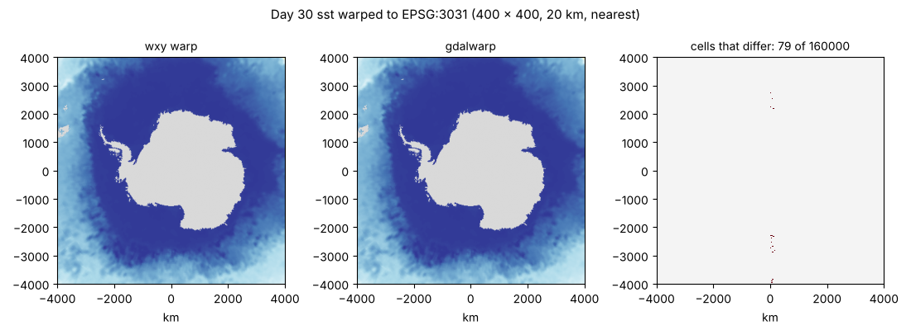

Each walk-through takes one public archive as it is published, reads it
through a byte-reference table or a virtual view without copying it, and
checks what it reads against GDAL. The scripts beside each page make every
figure and number on it.

::: {.cards .thumbs}

::: {.card}
[{fig-alt="MUR SST around Tasmania read through the published VRT"}](ghrsst/README.md)

### [Twenty-four years of MUR SST, one set of bytes](ghrsst/README.md)
GHRSST MUR daily COGs on Source Cooperative, read through the published
GDAL VRT, a 100-line script, zarr-python and wxy from one byte table.
:::

::: {.card}
[{fig-alt="BRAN2023 surface temperature read from its byte table"}](bran/README.md)

### [A year of BRAN2023 through its byte table](bran/README.md)
Ocean reanalysis netCDF4 on NCI THREDDS, read chunk by chunk by byte
range: maps, sections and time series, and what each costs.
:::

::: {.card}
[{fig-alt="OISST day 30 warped to EPSG:3031 by wxy and gdalwarp"}](../oisst-virtual.md)

### [A month of OISST as virtual Zarr](../oisst-virtual.md)
NOAA's daily OISST netCDF from its bucket as virtual Zarr, checked
against GDAL and warped to the Antarctic.
:::

::: {.card}
[{fig-alt="Four SST products over the Tasman Sea"}](cmems/README.md)

### [Four estimates of one sea (draft)](cmems/README.md)
BRAN2023, GHRSST MUR and Copernicus Marine Zarr side by side over the
Tasman Sea, each read in its own published shape.
:::

:::

Technique how-tos (zonal statistics, curvilinear grids, values at points,
caching) are under [How-tos](../vignettes/README.md); how the views and
codecs work is under [Explainers](../explainers/index.qmd).
