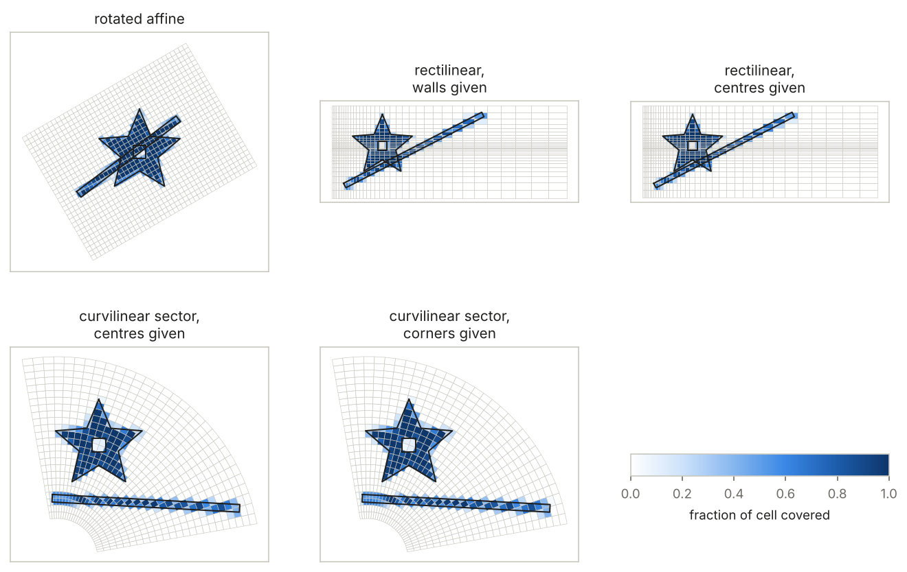
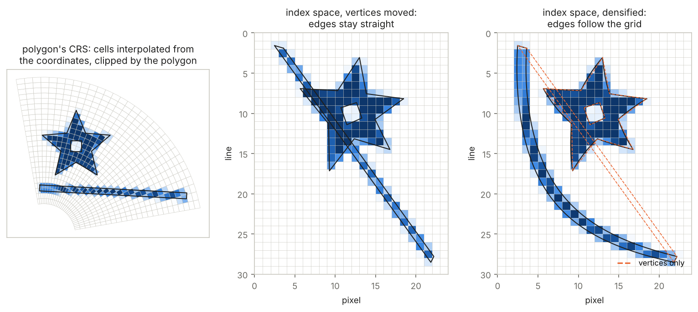
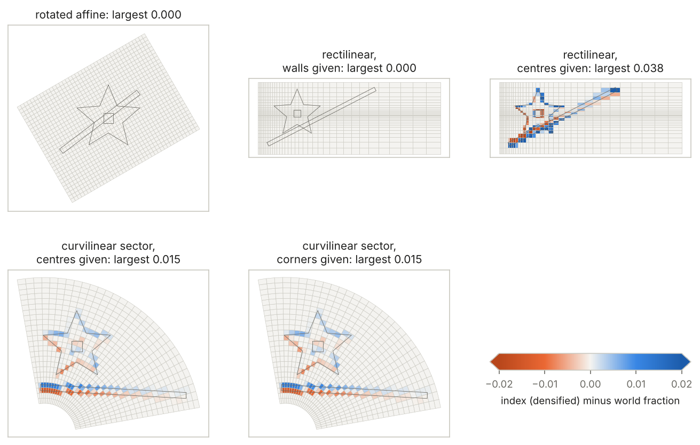
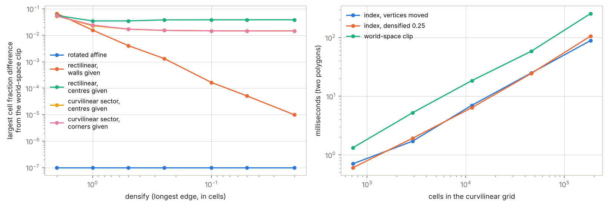

# Polygons on grids that are not a regular lattice

Coverage fractions (the fraction of each cell a polygon covers, as
exactextract and controlledburn give them) are usually computed on a
regular lattice: cells all the same size, rows and columns parallel to
the axes of the polygon's CRS. Many grids are not like that:

- **rotated affine**: a geotransform with rotation or shear terms;
- **rectilinear**: 1D x and y coordinates with uneven spacing (a
  stretched model grid);
- **curvilinear**: 2D coordinate arrays (a swath, an ocean model, a
  polar sector).

There are two ways to burn a polygon onto such a grid.

1. **Move the polygon to the grid.** Transform the polygon's vertices to
   fractional `(pixel, line)` and burn there, on a lattice of unit cells.
   This is what GDAL's rasterizer does, and what `wxy zonal --coverage`
   does today for every kind of source.
2. **Move the grid to the polygon** (coordinate matching and
   interpolation). Interpolate each cell's boundary from the grid's
   coordinates into the polygon's CRS and clip the polygon by it there.

This page compares the two on five grids, with two polygons each (a star
with a hole, and a long thin sliver), and checks the second against an
independent oracle (OGR intersections).



## What a cell is

Both methods need to agree on what a cell is before they can be compared.
On a curvilinear grid the cell is what the grid's own interpolation makes
of it: GDAL's geolocation transformer maps `(pixel, line)` into the CRS by
bilinear interpolation of the coordinate arrays, so a cell is the image of
its unit square under that map. A cell side is straight within each
bilinear patch and bends where it crosses into the next. With corner
coordinates the patches are the cells, and four corners trace each cell.
With centre coordinates each cell straddles four patches, so each side
bends once at its midpoint, and eight points (corners and side midpoints)
trace it. The world-space method clips with those eight points; the
index-space method uses the same partition, implicitly. So the two
methods share their cells and differ only in how they measure area.

## Two spaces



On the left, the curvilinear sector in its own CRS, with cells shaded by
the world-space fraction. In the middle, the same polygons with only
their vertices moved to index space: a straight edge stays straight, but
on this grid a straight line in the CRS is a curve in index space. The
sliver's long edges are moved from one end to the other in a single step
and cut straight across cells they never touch. On the right, the edges
are densified first (cut into pieces no longer than a twentieth of a cell
once moved, then moved), and now follow the grid. The dashed outline is
the vertices-only polygon, for comparison.

## Where index-space fractions are exact

Densifying fixes the shape of the polygon in index space. It does not fix
the measure: the index-space method reports the fraction of the unit
square covered, the world-space method the fraction of the cell's area.
They agree when the map from index space to the CRS is affine within each
cell, because an affine map scales all areas in a cell by the same factor.



- **Rotated affine**: exact, with or without densifying. An affine map
  keeps straight edges straight and keeps area ratios.
- **Rectilinear, walls given**: exact in the limit. Each cell is an
  axis-aligned rectangle, mapped affinely; edges bend only where they
  cross a wall, so densifying converges on the world answer (and cutting
  edges exactly at the walls would be exact).
- **Rectilinear, centres given**: not exact. Each cell straddles two
  interpolation patches in each direction, with different scales on
  either side of its centre, so its index-space area is not proportional
  to its world area. The difference is up to 4 percent of a cell here,
  where neighbouring cells differ in width by 8 to 18 percent.
- **Curvilinear sector**: not exact, whether centres or corners are
  given. A bilinear map does not scale areas evenly within a cell. The
  difference is largest on the inner rows, where cells are most
  trapezoidal: up to 1.5 percent of a cell.



On the left, the largest per-cell difference from the world-space clip as
the densify step shrinks (rotated affine sits at the plot's floor: it is
exact). Without densifying (the leftmost points and the oracle table
below), whole cells are wrong along long edges. On the right, the cost on
ever finer sector grids, with the same two polygons. Densifying costs
nothing measurable; the world-space clip is about two and a half times
the index-space burn, and grows with the cells it clips.

## The oracle

`plot.py` builds each cell outline as an OGR polygon and intersects it
with each polygon (GEOS). The world-space method matches to within
1e-12 of a cell everywhere. `oracle.csv` has the largest difference per
case and polygon for each method:

| case | world-space clip | index, densified | index, vertices only |
|---|---|---|---|
| rotated affine | 2e-13 | 3e-8 | 3e-8 |
| rectilinear, walls given | 2e-13 | 5e-5 | 1.0 |
| rectilinear, centres given | 8e-14 | 0.039 | 1.0 |
| curvilinear sector, centres given | 7e-14 | 0.015 | 1.0 |
| curvilinear sector, corners given | 3e-14 | 0.015 | 1.0 |

(The index-space numbers near 1e-8 are controlledburn's fractions, which
are single precision.) The Rust tests in wxylib/core
(`crates/wxy-warp/tests/nonaffine.rs`) check the same things without
Python: each polygon's covered cell areas sum to its own area, rotated
affine is exact in index space, rectilinear with walls converges, and the
cell-centre rule (GDAL's, in index space) gives the same cells as testing
the grid's own centre coordinates on an affine grid.

## The cell-centre rule

The same split applies to the cell-centre rule. GDAL tests the centre of
each unit cell against the polygon moved to index space; the alternative
tests the grid's centre coordinates against the polygon where it is. On
the rotated grid the two agree cell for cell. On the others, with
vertices moved one at a time, the sliver gains and loses dozens of cells,
for the same reason as the coverage above.

## What this suggests

- **Rotated affine needs nothing new.** Move the polygon with the
  inverse geotransform and burn as usual; it is exact. A burn engine can
  take rotation as an input transform rather than a grid type.
- **Rectilinear is best handled natively.** With walls known, a burn
  engine whose axes take a list of walls (the axis seam in
  controlledburn-rs PR #8, stage 1 of its grid-geometry plan) is exact in
  the polygon's CRS, with no transform at all. Given centres, the walls
  have to be chosen (midpoints are the usual choice, and are what the
  interpolation implies); after that it is the walls case.
- **Curvilinear has no exact index-space answer.** Densified index-space
  burning is fast and within about 1.5 percent of a cell on this grid;
  the world-space clip is exact for the cell the coordinates define and
  costs a few times more. Which is right depends on whether a fraction is
  meant as a share of index space or of area.
- **Densify by default on any non-affine grid.** Moving vertices alone
  is what GDAL does, and it is wrong by whole cells along long edges.
  Densifying costs nothing here.

## Running it

```
# in wxylib/core
cargo test -p wxy-warp --test nonaffine
cargo run --release -p wxy-warp --example nonaffine_cover -- nonaffine.json

# here, with osgeo.gdal and matplotlib
python3 plot.py nonaffine.json
```

The grids and polygons are defined in
`crates/wxy-warp/tests/support/grids.rs`. The methods are
`polygon_coverage_by` with `CoverMethod::Index { densify }` or
`CoverMethod::World`, in `crates/wxy-warp/src/cover.rs`.
