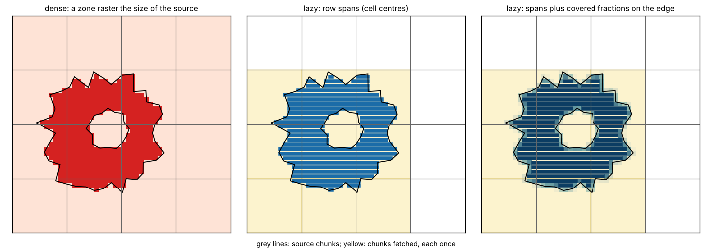
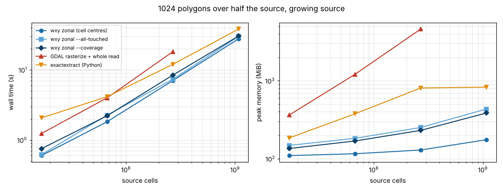
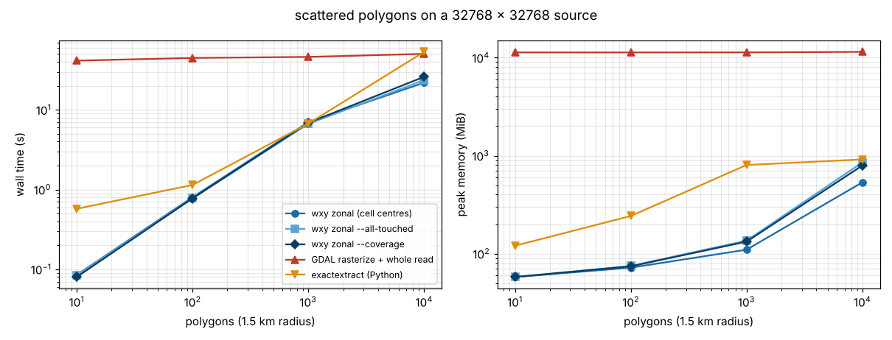

# Zonal statistics by lazy rasterization

`wxy zonal` summarises a raster under polygons (count, sum, mean, min,
max per polygon and per leading slice) without ever making a raster of
the polygons. Each polygon becomes row spans of cells; the spans are
grouped by the source chunks they cross; each chunk is read and decoded
once and summarised for every polygon over it.



Three rules pick the cells:

- cell centres, as GDAL's rasterizer burns a polygon (the default);
- `--all-touched`, as GDAL's `ALL_TOUCHED`;
- `--coverage`, every cell a polygon covers, weighted by the fraction it
  covers (controlledburn, exactextract's algorithm).

```
wxy zonal source.tif zones.geojson --crs EPSG:32755 --coverage > stats.csv
```

## What it costs, against two other ways

- **GDAL rasterize + whole read**: the usual raster workflow. Burn zone
  ids into a raster the size of the source with GDAL's rasterizer
  (rasterio), read the whole source, reduce with numpy.
- **exactextract**: the Python package (0.3.0), with its default
  feature-sequential strategy. Coverage fractions, as `--coverage`.
- **wxy zonal**: the three rules above.

Sources are synthetic float32 GeoTIFFs, tiled 512 x 512, deflate, with a
lake of nodata. Polygons are 64-vertex stars, every fourth with a hole.
Times are wall-clock, best of two after a warm-up run, with the files in
the page cache; memory is each process's peak resident set. One machine:
4 cores, 15 GiB. wxy reads and decodes on one thread.

### A growing source, 1024 polygons covering half of it



| source | wxy centres | wxy --coverage | GDAL dense | exactextract |
|---|---|---|---|---|
| 4096 x 4096 | 0.6 s, 110 MiB | 0.8 s, 136 MiB | 1.2 s, 364 MiB | 2.1 s, 185 MiB |
| 8192 x 8192 | 1.8 s, 116 MiB | 2.2 s, 169 MiB | 4.0 s, 1.2 GiB | 4.2 s, 377 MiB |
| 16384 x 16384 | 7.0 s, 130 MiB | 8.4 s, 231 MiB | 18 s, 4.5 GiB | 12 s, 808 MiB |
| 32768 x 32768 | 28 s, 175 MiB | 30 s, 386 MiB | not run (over 15 GiB) | 38 s, 830 MiB |

Every chunk is under a polygon here, so every method reads the whole
source and time grows with it. The dense way's memory is the source and
the zone raster together; wxy's is the polygons' spans plus a batch of
chunks, so it barely grows.

### A 32768 x 32768 source, 10 to 10000 scattered polygons



| polygons | wxy centres | wxy --coverage | GDAL dense | exactextract |
|---|---|---|---|---|
| 10 | 0.09 s, 58 MiB | 0.08 s, 58 MiB | 41 s, 11 GiB | 0.6 s, 120 MiB |
| 100 | 0.8 s, 72 MiB | 0.8 s, 74 MiB | 45 s, 11 GiB | 1.1 s, 242 MiB |
| 1000 | 7.0 s, 110 MiB | 6.9 s, 133 MiB | 46 s, 11 GiB | 6.7 s, 803 MiB |
| 10000 | 22 s, 535 MiB | 26 s, 795 MiB | 50 s, 11 GiB | 53 s, 916 MiB |

Here the lazy way reads only the chunks under polygons, so time follows
the polygons, not the source. The dense way always reads and burns the
whole billion cells. At 10000 polygons most of wxy's memory is the
GeoJSON parsed as a generic JSON tree in the CLI, not the plan.

## Do they agree?

`python3 bench.py check`:

- **Cell centres against GDAL**: identical counts and sums for every
  polygon that overlaps no other. Where polygons overlap (10 to 1099 of
  them per run) a zone raster can hold only one zone per cell and the
  last one burned wins; there wxy matches GDAL burning that polygon on
  its own, every time. Overlapping zones are a case the dense way gets
  wrong and the lazy way gets right.
- **Coverage against exactextract**: covered cell counts within 4e-6 of a
  cell and means within 2e-9, across all runs.

## What we get, what it costs, what if we didn't

What we get: zonal statistics whose memory follows the polygons'
perimeter and a batch of chunks, not the source, and whose time follows
the chunks under polygons; overlapping zones summarised correctly; the
same plan for Zarr and COG, local or remote, and for every leading slice
(time, depth) of a multidimensional source. What it costs: a port of
GDAL's scanline rasterizer and one dependency (controlledburn). Without
it, a large source means a zone raster as big as the source, or one
windowed read per polygon.

Next: decode chunks on more than one thread (wxy's time here is mostly
deflate), parse GeoJSON features without a generic tree, and merge the
single-cell spans `--all-touched` adds along polygon edges.

## Run it

```
python3 bench.py data    # about 4.6 GB in $WXY_BENCH (default ./data)
WXY=path/to/wxy python3 bench.py run
python3 bench.py check
python3 plot.py
```

Needs rasterio, numpy, pandas, exactextract and matplotlib, and a `wxy`
binary built from wxylib/core (`cargo build --release -p wxy-cli`).
