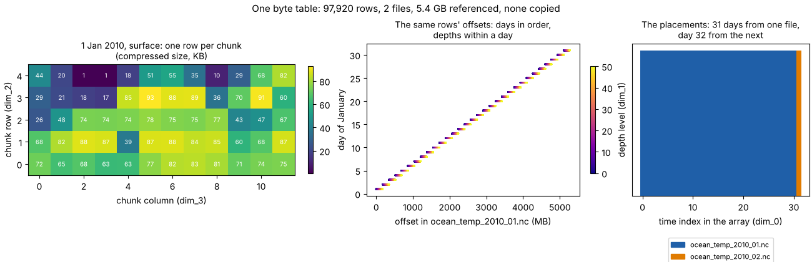

# Byte-reference tables: one table, several views

Most archives of gridded data are already chunked. A netCDF4 or HDF5
variable is stored as compressed chunks, a COG as compressed tiles, and
each chunk sits at a known byte offset in its file. A byte-reference
table writes those positions down, one row per chunk, so the archive can
be read as one array without copying it. Every other form of "virtual
Zarr" (kerchunk, Icechunk virtual references, a multidimensional VRT) is
a rendering of the same rows. This page explains what the table holds,
how a reader finds one chunk in it, what each view is for, and what a
table has to state so that its readers agree.

The format is the shared
[mdim-refs/0.2 spec](../design/specs/mdim-refs-0.2.md); wxylib reads it
and does not own it. The reader is `wxy-refs` in
[wxylib/core](https://github.com/wxylib/core).



The figure comes from [`byte-tables-figure.py`](byte-tables-figure.py),
which reads the 32-day BRAN2023 table in
[wxylib/fixtures](https://github.com/wxylib/fixtures/tree/main/mdimrefs/bran2023-temp-201001)
with nothing but Parquet.

## A row

A row says where one chunk's bytes are:

| `dim_0` .. `dim_3` | `present` | `path` | `offset` | `size` | `info` |
|---|---|---|---|---|---|
| 0, 0, 0, 0 | 1 | `.../ocean_temp_2010_01.nc` | 46353 | 74186 | `COMPRESSION=DEFLATE; FILTER=SHUFFLE; ENDIANNESS=LITTLE` |

The `dim_` columns are the chunk's key in the array's chunk grid (day,
depth, chunk row, chunk column here). A reader that wants that chunk asks
the server for `size` bytes starting at `offset`, then decodes them with
the codec that `info` names. Nothing else is needed: no netCDF library,
no HDF5, no file open.

A chunk is in one of three states:

- **referenced**: `present = 1`, with `offset` and `size`;
- **inline**: `present = 1`, with the bytes themselves in `data` (small
  arrays such as coordinates);
- **absent**: `present = 0`, never written by the producer; a reader
  returns the array's fill value.

A key with no row at all means the source was not scanned. That is an
error, not a fill: the difference between "known empty" and "not looked
at" is kept in the table.

## Three layers

A table over many files is built from three layers, each held once.

1. **Physical.** For each source file, the byte range of every chunk,
   keyed by the chunk's position within that file. This is what a scan
   of one file returns (GDAL's raw block info, an HDF5 chunk walk, a
   TIFF's tile offsets). It knows nothing about the dataset the file
   belongs to.
2. **Plan.** Where each file's part sits in the whole array: in the
   figure, the January file supplies days 1 to 31 and the February file
   day 32. These are the `<Source>` entries of a GDAL multidimensional
   mosaic VRT (source slab and destination offset), copied into the table
   so it stands on its own.
3. **View.** The global chunk index, one row per chunk of the whole
   array, computed from the first two. For each axis,

   ```
   global key = key in source - source offset / chunk + destination / chunk
   ```

   The published Parquet export (`refs_<array>.parquet`) is this view.

Keeping them apart is what makes a table maintainable. A rescanned file
changes only its own physical rows. A file that moves changes only a
path rewrite (the `remap` table, applied at publish or at read, as
`wxy warp --remap`). A new day appends one file's rows and one placement.

## Finding one chunk

Filtering the view on a computed key scans every row. For a single chunk
the lookup runs the other way: find the placement whose destination slab
holds the key, subtract to get the key within that source, and look the
row up by its primary key. On a table of about a million chunks that is
under a millisecond, against one to two seconds through the view.

`wxy-refs` reads the published view. It loads the rows for the arrays it
opens and serves them to [zarrs](https://github.com/zarrs/zarrs) as
storage: a present row becomes a range request through `object_store`
(local files, HTTP(S), S3), an inline row returns its bytes, an absent row
reads as fill. A table of tens of millions of rows does not yet fit this
load-everything approach; lookup by row group is the next step for it.

## The views, and who reads them

| View | What it is | Read by |
|---|---|---|
| `mdim.vrt` | the plan as GDAL XML: which file supplies which slab | GDAL, osgeo.gdal, GDAL's xarray backend |
| flat (`refs_<array>.parquet` and `arrays.json`) | the view rows and the array metadata | wxy, DuckDB, R and Python with only Parquet and HTTP, the browser |
| kerchunk Parquet | the same rows in fsspec's reference layout | xarray through fsspec, GDAL (`/vsikerchunk_parquet_ref/`), wxy |
| Icechunk | the rows as virtual chunk references in a versioned repository | the Icechunk and xarray stack, wxy |

The views agree in bytes. On the BRAN2023 and GHRSST MUR stores, wxy
reads the flat, kerchunk and Icechunk views and gets the same values as
GDAL reading the `mdim.vrt`, window for window. They do not agree in who
can read them: GDAL's Zarr driver cannot decode the TIFF predictor that
MUR's tiles use, so GDAL users go through the VRT there (see
[COG tiles as Zarr chunks](cog-tiles.md)). The VRT is the slowest to
start on a long series, because GDAL opens source files to plan a read
(see [Multidimensional VRT views](mdim-vrt.md)), and the table views start
in under a second. That is why a store publishes all of them: the VRT as
the oracle and GDAL's way in, the table as the fast and portable one.

## What a table has to state

A reader can only be as right as the description it is given. The
metadata in `arrays.json` (data type, fill, chunk shape, codec, CF
attributes) is copied from the source at harvest, and every reader trusts
it. Two things go wrong in practice:

- **Rounded packing.** A `scale_factor` written with too few digits
  (`0.0078` where the source file has `0.0077822199`) decodes every value about half a
  degree too cold in BRAN's temperature, in every reader at once, because
  they all agree with the table. Comparing the table's attributes with
  the source file's catches it; comparing readers with each other does
  not.
- **Two fills.** A CF `_FillValue` in the attributes and a format fill
  for absent chunks are different things. A reader keeps the CF value for
  masking and uses the format fill only where no chunk exists.

The checks belong at the producer's publish step: attributes against
the source, one window against GDAL, and the VRT's source slabs complete.
The design note [m17](../design/docs/m17-self-describing-stores.md) has
the full contract.

## In wxylib

```sh
# a local table directory, or an s3:// prefix holding one
wxy warp --crs EPSG:3031 --extent -4e6 -4e6 4e6 4e6 --size 800 800 \
  --source-array /temp --remap public  path/to/store/flat  out.zarr
```

- `wxy warp`, `wxy points` and `wxy zonal` take a table (the flat
  export or a kerchunk Parquet store) as their source.
- `wxy warp --remap TARGET` rewrites source paths through the table's `remap`
  rows (a mirror, or local copies).
- `wxy warp --cache DIR` keeps the bytes each run fetches (see
  [Keep the bytes a run reads](../vignettes/cache/README.md)).
- `--dry-run` prints the chunk keys a run will fetch before any is read.

Worked examples: [a month of OISST](../oisst-virtual.md),
[a year of BRAN2023](../examples/bran/README.md) and
[the MUR SST archive](../examples/ghrsst/README.md).
