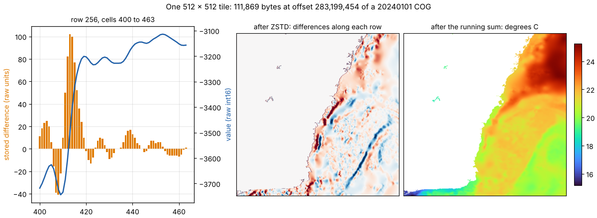

# COG tiles as Zarr chunks: what every view has to say about the bytes

A Cloud Optimized GeoTIFF is already a chunked array. Its header lists the
byte offset and length of every tile, and a tile is compressed on its own,
so one HTTP range request and a decoder give back one block of the array.
A byte-reference store turns those header lists into a table (one row per
tile: `path`, `offset`, `size`), and each view of the store (kerchunk
Parquet, Icechunk, the flat table itself) presents the table to a
different kind of reader. Every view then has to say, in its own
vocabulary, how a tile's bytes become values. This page explains what has
to be said, using one tile of the GHRSST MUR archive (see the
[GHRSST example](../examples/ghrsst/README.md)), and where each reader
stands.



The figure comes from [`cog-tiles-figure.py`](cog-tiles-figure.py), which
decodes the tile with nothing but a range request, ZSTD and NumPy.

## Two steps per tile

The MUR COGs are written by GDAL with `COMPRESS=ZSTD` and `PREDICTOR=2`.
A tile is undone in two steps:

1. **Decompress.** The tile's bytes are one ZSTD frame. For an int16 tile
   of 512 x 512 the result is 524,288 bytes.
2. **Undo the horizontal predictor.** TIFF predictor 2 stores each value
   as the difference from its left neighbour, row by row; the first value
   of each row is stored as it is. A cumulative sum along each row restores
   the values. In int16 arithmetic the sum wraps exactly as the encoder's
   subtraction did, so no widening is needed:

   ```python
   v = np.frombuffer(zstd_decode(raw), "<i2").reshape(512, 512)
   values = np.cumsum(v, axis=-1, dtype=np.int16)
   ```

The predictor is why the compressed tile is small: neighbouring sea
surface temperatures differ by a few thousandths of a degree, so the
differences are small integers near zero (the middle panel), and ZSTD
packs them far better than the values. It is also the step a reader most
often lacks.

Scale, offset and nodata are not codec steps. They are attributes of the
array (`scale_factor` 0.001, `add_offset` 25, fill -32768 for
`analysed_sst`), applied after decoding by readers that unpack.

## How each view names the steps

| View | Compression | Predictor | Who decodes it |
|---|---|---|---|
| COG (TIFF tags) | `Compression=ZSTD` | `Predictor=2` | GDAL's GTiff driver, async-tiff, tifffile, any TIFF reader with ZSTD |
| kerchunk Parquet (Zarr v2) | compressor `zstd` | filter `imagecodecs_delta` (`axis` -1) | zarr-python with imagecodecs' numcodecs registered; wxy (`wxy-predictor`); GDAL's Zarr driver only with a filter plugin |
| Icechunk (Zarr v3) | codec `zstd` | codec `HorizontalDeltaCodec` (the virtual-tiff name) | zarr-python with that codec registered; wxy; not GDAL yet |
| flat table (mdim-refs) | `codec` in `arrays.json`, as the Zarr v2 view | the same filter, and `info` per row: `COMPRESSION=ZSTD; PREDICTOR=2` | wxy; a short script (`mur_table.py` in the example) |

GDAL is the odd one out: it reads the COGs natively, but its Zarr driver
does not know either predictor codec. In Zarr v2 it looks up an unknown
filter id in its compressor registry, so a small plugin that registers
`imagecodecs_delta` there is enough for it to read the kerchunk view
(checked on all five GHRSST windows). Zarr v3 codecs are built into the
driver, so the Icechunk view needs a change in GDAL itself. Until then,
GDAL and the GDAL-backed xarray readers use the multidimensional VRT view,
which points at the COGs and lets the GTiff driver decode. The
[multidimensional VRT explainer](mdim-vrt.md) covers what that view costs.

## Three things the table has to get right

- **Edges.** The MUR grid is 17999 x 36000, not a whole number of 512
  tiles. TIFF stores edge tiles at full size, and the padding decodes as 0
  (25 degrees C once scaled), not as fill. A Zarr reader crops the last
  chunk to the array's shape, so the padding never shows, but a reader
  that pastes whole tiles must crop too. In the 2024 table the bottom row
  of tiles (rows 17920 to 17999, mostly padding) compresses to 43 bytes.
- **Constant tiles.** A tile holding one value throughout (all land as
  fill, or all -1.8 degrees C under sea ice) compresses to 63 bytes. They
  are 16% of the 2024 table. The size alone tells a planner which tiles
  hold no information, before any read.
- **Change.** A day's COGs are rewritten at the same URL when the final
  analysis replaces the near-real-time one, and every tile offset in that
  file moves. A table that records each source's checksum or etag (the
  STAC items carry `file:checksum` and `file:size` for rewritten assets)
  can tell which rows are stale. The VRT is not affected: it names files,
  not byte ranges.

## How this affects wxylib

wxy reads the kerchunk, Icechunk and flat views through
[wxy-predictor](https://github.com/wxylib/core/tree/main/crates/wxy-predictor),
which implements `HorizontalDeltaCodec` as a row-wise running sum
(`wxy-refs` maps the kerchunk name `imagecodecs_delta` onto it), and is
checked against GDAL's hashes of the COGs. The same check is how a new
reader of these views earns trust: read the windows of the store's
manifest and compare SHA-256 with GDAL reading the COGs.
