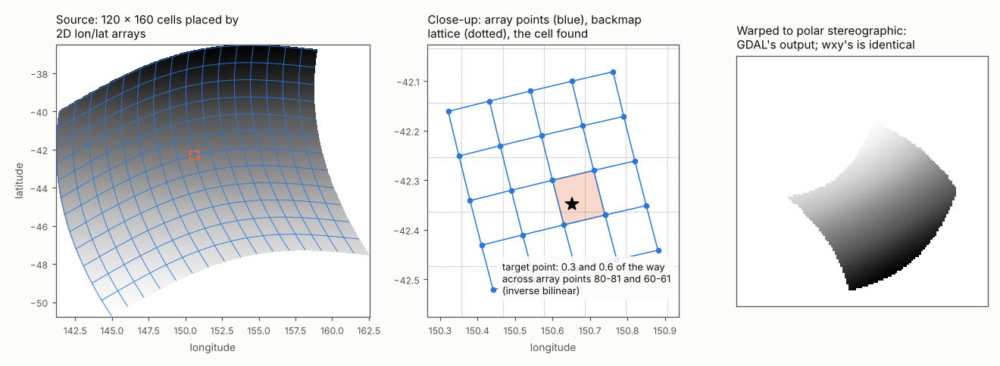

# Curvilinear grids: GDAL's geolocation-array transformer

Many satellite swaths and ocean model grids have no geotransform. Each
cell's position is stored instead, in two 2D arrays of longitude and
latitude (CF coordinates, in netCDF terms). Going from a cell to its
position is a lookup. A warp needs the other direction, from a position
to the cell that holds it, and for a curved, sheared grid there is no
formula for that: it is a search. This page explains how GDAL does the
search, how wxylib ports it, and how the two are compared.

The code is [rwarp](https://github.com/hypertidy/rwarp)'s
`geoloc_transform` module, called from `wxy-warp` in
[wxylib/core](https://github.com/wxylib/core). The GDAL code it ports is
`alg/gdalgeoloc.cpp` (GDAL 3.14).

## Forward: cell to position

GDAL treats neighbouring array points as the corners of a quadrilateral
and interpolates bilinearly inside it (`PixelLineToXY`). Off the edge of
the arrays it extends the nearest quadrilateral. Where the array values
sit is a convention:

- `PIXEL_CENTER` (what GDAL's netCDF driver sets for CF coordinates):
  array point `(i, j)` is the centre of cell `(i, j)`, at pixel
  coordinates `(i + 0.5, j + 0.5)`;
- `TOP_LEFT_CORNER`: the arrays have one more row and column than the
  grid and hold the cell corners, at whole pixel coordinates.

## Inverse: position to cell

The inverse has two stages.

**The backmap** (`GenerateBackMap`), built once. It is a regular grid in
the arrays' CRS that stores, for each of its nodes, the source pixel
position found there. Its spacing is chosen so that it has about 1.3 times
as many nodes as the source has cells (`sqrt(area / (nx * ny * 1.3))`).
GDAL fills it by walking the source in steps of 1/1.3 pixel and
transforming each sample forward:

- if a backmap node falls inside a quadrilateral next to the sample, the
  node gets that quadrilateral's exact inverse position (below), and is
  final;
- otherwise the sample's own pixel position is spread over the four
  surrounding nodes with bilinear weights, and kept at a node only while
  the node's averaged position still lands within 2 backmap cells of the
  sample;
- after the walk, the weights are divided out, empty nodes are filled from
  their neighbours (GDAL's fill-nodata, up to 3 nodes away, one smoothing
  pass), and short gaps along each row (2 pixels or less) are bridged.

The backmap is stored as float32, as GDAL stores it.

**The refinement**, for each position transformed. GDAL interpolates the
backmap bilinearly to get an estimate of the source position, then
searches the quadrilaterals around that estimate in growing square rings,
up to 3 cells out (5 near the poles), for one that contains the point
(boundary included). In that quadrilateral it solves the bilinear
equations exactly for the point's fractional position
(`GDALInverseBilinearInterpolation`). If no quadrilateral holds the point,
the transform fails for that point, which the warper treats as outside the
source.

So the backmap only has to be close: the refinement makes the answer
exact within the quadrilateral. The backmap's details still matter,
because they decide which quadrilateral the search starts in, and so which
one it finds first where the grid folds over itself or the point sits on
a shared edge.

## The antimeridian

When the arrays are geographic and all longitudes are within -180 to 180,
GDAL interpolates longitude across the antimeridian rather than through
zero: a neighbour more than 170 degrees away on the other side is shifted
by 360 before interpolating, and the result shifted back. A quadrilateral
whose corners straddle the antimeridian is tested at both -180 and +180,
and the backmap walk does the same for nodes past 180.

## Warping with it

To the warper the geolocation transformer is one more transformer between
source pixels and the arrays' CRS, chained with the CRS transform to the
target and wrapped in the approximate transformer as usual (see
[how the warper works](warper.md)). The chunk plan, source windows and
kernels are unchanged.

## How wxylib does it

| GDAL | rwarp (`geoloc_transform`) |
|------|-------|
| `GDALGeoLocTransformInfo` | `GeolocArrays` |
| `PIXEL_OFFSET`, `LINE_STEP`, `GEOREFERENCING_CONVENTION` and the other options | `GeolocOptions` |
| `PixelLineToXY` | `GeolocArrays::pixel_line_to_xy` |
| forward transform | `GeolocArrays::pixel_to_geo` |
| `GenerateBackMap`, its fill-nodata pass, then the ring search | `GeolocArrays::geo_to_pixel` with `GeolocInverse::Backmap` |
| `GDALGenImgProjTransform` with a geolocation side | `GenImgGeolocTransformer` |

The backmap follows GDAL's arithmetic order and its block order (256 x 256
blocks, rows of blocks first), since the order in which samples reach the
backmap decides which value a node keeps. rwarp's own default inverse
(`GeolocInverse::QuadIndex`) searches an index of every quadrilateral
instead, without a sampled backmap; wxylib asks for `Backmap`, so that its
warps match GDAL's cell for cell.

`wxy-warp` builds the `GeolocArrays` and decides one option itself: it
interpolates longitudes across the antimeridian (`with_lon_wrap`) when the
arrays' CRS is geographic and every longitude lies in -180 to 180, as GDAL
does. Missing samples are NaN.

`wxy-zarr` reads CF 2D longitude and latitude coordinates and gives them
to the warper as a curvilinear mapping. Cell centres use `PIXEL_CENTER`,
as GDAL does. With 2D CF bounds (`wxy warp --bounds`) the cell corners are
used instead, through `TOP_LEFT_CORNER`.

## How the match is tested

[wxylib/fixtures](https://github.com/wxylib/fixtures) `curvilinear/`,
made by `scripts/make_curvilinear_fixtures.py`: a source GeoTIFF with no
geotransform, wrapped in a VRT whose `GEOLOCATION` metadata points at the
longitude and latitude arrays, warped by GDAL through rasterio. The same
arrays are written raw for wxylib. Six cases:

- a curved, sheared swath over south-eastern Australia to lon/lat, to
  lon/lat three times coarser, and to polar stereographic;
- the same swath placed by its cell corners (`TOP_LEFT_CORNER`), to
  lon/lat and to polar stereographic;
- a ring around the south pole (60 to 85 degrees south, every
  longitude, so across the antimeridian) to polar stereographic.

`cargo test -p wxy-warp --test curvilinear` warps each with nearest,
bilinear and cubic and requires every cell to equal GDAL's: 18 of 18
identical. The figure is made by [geoloc-figure.py](geoloc-figure.py) from
the fixture arrays and GDAL's output for the swath to polar stereographic.
