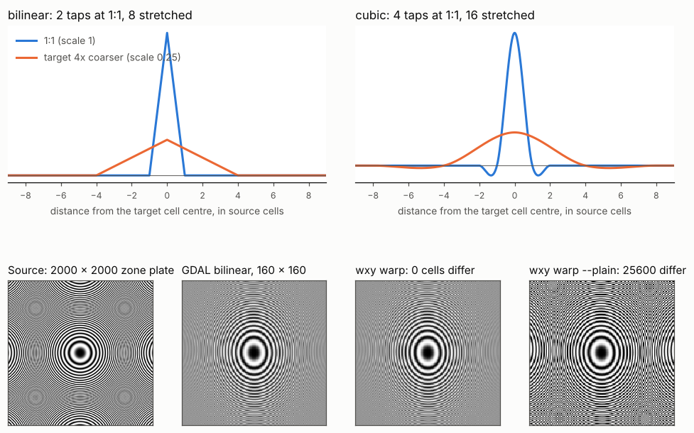

# Resampling kernels: weights, stretch, edges and nodata

Once the warper knows where a target cell's centre lands in the source
(see [how the warper works](warper.md)), a kernel turns the source cells
around that point into one value. This page explains GDAL's warp kernels
for nearest, bilinear and cubic, the details that decide their last digit,
and how wxylib reproduces them.

The code is the `warp` module of
[rwarp](https://github.com/hypertidy/rwarp) (`src/warp.rs`), which
`wxy-warp` in [wxylib/core](https://github.com/wxylib/core) calls once
per chunk. The GDAL code it ports is `alg/gdalwarpkernel.cpp` (GDAL 3.14,
the version of wxylib's oracles). Until core#22, wxylib carried its own
port of the GDAL 3.12 kernels (`wxy-resample`); it was retired once the
oracles moved to GDAL 3.14, so that one port, in rwarp, serves both.

## The weights

A kernel is a weight function of distance, applied separately along x and
y and multiplied:

- **Nearest** takes the cell the point falls in. No weights.
- **Bilinear** is a tent: weight `1 - |d|` within one cell of the point,
  so 2 taps per axis, 4 in all.
- **Cubic** is Catmull-Rom (cubic convolution with `a = -0.5`): positive
  within one cell, slightly negative between one and two, so 4 taps per
  axis, 16 in all. The negative lobes sharpen edges, and can overshoot
  the source range (which is why results are clamped to the cell type).

Distances are in source cells from the point to each cell centre, with
`(0.5, 0.5)` the centre of the window's first cell.

## The stretch

When the target is coarser than the source, a 1:1 kernel samples the
source: a target cell four source cells wide still reads only the 2 or 4
cells nearest its centre, and fine detail aliases into patterns that are
not in the data. GDAL instead stretches the kernel by the chunk's scale
`s` (below 1 for a coarser target), which GDAL 3.13 and later estimate by
transforming unit squares sampled over the chunk (rwarp's
`estimate_scale`; GDAL 3.12 took the ratio of the chunk's target size to
its source window size):
the weight of a cell at distance `d` becomes `w(d * s)`, and the radius
grows to `ceil(r / s)`. Bilinear at a quarter scale covers 8 cells per
axis rather than 2, cubic 16 rather than 4, and the weights are normalised
by their sum. Each target cell then averages over the source cells under
it.

The bottom row is a zone plate (rings that get finer away from the
centre) warped with bilinear to a grid about ten times coarser. GDAL's
stretched kernel averages the fine outer rings to grey; `wxy warp`, which
ports it, gives the same 25,600 values. `wxy warp --plain` uses a 1:1
kernel and shows rings where the source has none at that scale. The figure
is made by [kernels-figure.py](kernels-figure.py) (drawn with GDAL 3.12
and the earlier port). (The source panel is
itself drawn at reduced size, so its outer rings alias on screen.)

A scale at or above 0.95 counts as 1:1 (the hand-written 4 and 16 tap
formulas run), and a scale within 0.05 of `1/n`
snaps to `1/n`, so a target exactly half the source resolution gets a
kernel exactly twice as wide.

## Two paths, and which one runs

GDAL has separate kernels for two situations, and their arithmetic
differs, so which one runs matters to the result:

- **No masks** (`GWKResampleNoMasksOrDstDensityOnlyThread`): no source
  nodata, no target nodata, and a cell type of byte, int16, uint16 or
  float32. Weights are applied and the result rounded straight to the cell
  type. At 1:1 the 4-tap and 16-tap formulas are written out by hand
  (`GWKBilinearResampleNoMasks4SampleT`, `GWKCubicResampleNoMasks4SampleT`);
  stretched kernels go through `GWKResampleNoMasks_SSE2_T`.
- **Masks** (`GWKRealCase` and friends): any nodata, or any other cell
  type. Each tap carries a validity (a density of 0 or 1); invalid taps
  are skipped, and the kernel returns both a value and the density it
  found, which decides how the value is written (below).

## Edges and invalid cells

A kernel near the edge of the source window has taps that fall outside
it. GDAL drops those taps and renormalises over the ones left, so a cell
on the window edge is an average of fewer cells, not a value pulled
towards zero. Cubic at 1:1 does not renormalise: if any of its 16 taps is
outside the window or invalid, it falls back to bilinear for that cell.

## Writing the value

On the masks path the density says how much of the kernel's weight landed
on valid cells (`GWKSetPixelValueReal`):

- below 0.0001, nothing is written and the target cell keeps its nodata;
- below 0.9999, the value is blended with what the target cell already
  holds, if that is a valid value, weighted by the density (so a partial
  cell near a nodata edge is mixed with an earlier write rather than
  replacing it);
- otherwise the value is written as is.

Then the value is converted to the cell type (`GWKClampValueT`): clamped
to the type's range and rounded half up for integers, cast for floats. If
the result equals the target's nodata value it is stepped off it by one
(integers) or to the next float (`AvoidNoData`), so a real value is never
mistaken for missing data.

## Arithmetic order

Floating point addition is not associative, so the order of the sums
decides the last bit, which in turn decides which way a value rounds to
an integer type. rwarp follows GDAL's order:

- the stretched no-mask kernel sums four rows at a time with four lanes
  per row, combined as `(lane 0 + lane 2) + (lane 1 + lane 3)`, the order
  of GDAL's SSE2 build;
- weights are computed in groups of four, as `GWKComputeWeights` does;
- signed integers round as `floor(v + 0.5)`, unsigned as a truncating
  cast of `v + 0.5`.

## How wxylib does it

rwarp's `warp` takes a source buffer (one chunk's window, with its offset
in the full source), a transformer, the target size and offset, and
options: the method, the kernel scale (`KernelScaling::Fixed` with the
chunk's scale here), nodata and, for average and mode, the footprint and
tie rule. rwarp's `plan` module plans the chunks and windows as GDAL does
(see [the warper](warper.md)) and estimates each chunk's scale with
`estimate_scale`; `warp_chunks` calls `warp` once per chunk. `warp` itself
retries points just outside a window with an exact transform, as
`GWKCheckAndComputeSrcOffsets` does.

Point extraction does not use these kernels: GDAL's point reads use
`InterpolateAtPoint`, a different implementation, which `wxy-warp` ports
separately (`extract.rs`).

## How the match is tested

Through the warps. The oracle cases in
[wxylib/fixtures](https://github.com/wxylib/fixtures) (`warp/`, made by
`scripts/make_warp_fixtures.py` with GDAL 3.14dev through osgeo.gdal) run
every kernel path:

- byte, int16, uint16 and float32 sources, so both the no-mask and the
  masks path;
- a source with nodata over the ocean (`worldnd-to-3031`) and a float32
  source with nodata (`polar-to-4326`), for skipped taps, partial density
  and the nodata step;
- targets near 1:1 and coarser (`utm-to-4326-coarse`,
  `rgb-to-3857-coarse`, and the overview cases), for the 4-tap formulas
  and the stretched kernels.

`cargo test -p wxy-warp` (`tests/gdal_oracle.rs`) requires every cell of
every case to equal GDAL's, for nearest, bilinear and cubic. Lanczos and
average agree in all but a handful of cells, off by one or two after
rounding; mode agrees for integer types, while for floating-point types
GDAL only moves its mode to a value on that value's second source cell,
so continuous data keeps the first value, where rwarp takes the value
covering the most area. A second test
(`plain_kernel_samples_coarse_targets`) checks that the 1:1 kernel of
`--plain` does differ from GDAL on a coarser target, so the stretch is
what makes the match. The figure above repeats both checks on a harder
source.
