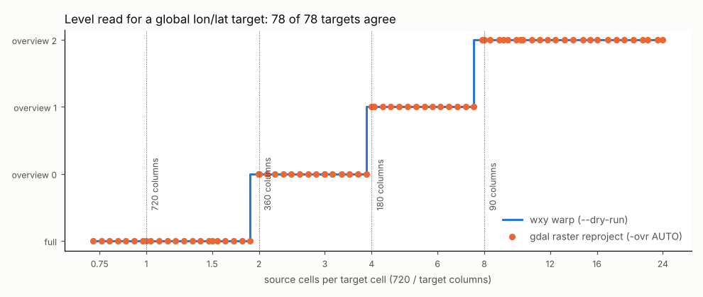

# Overview selection: gdalwarp's -ovr AUTO

A Cloud Optimized GeoTIFF carries overviews: the same data at half, a
quarter, an eighth of the resolution. A warp to a coarse target does not
need the full-resolution cells. Reading an overview instead costs a
fraction of the bytes, and the kernel has fewer cells to average. Which
overview to read is a rule, and the rule changes the output, because the
values in an overview are already averaged. This page explains gdalwarp's
default rule, `-ovr AUTO`, how wxylib reproduces it, and how the choice is
compared with gdalwarp's.

The code is `choose_overview` and `warp_pyramid` in
`crates/wxy-warp/src/lib.rs` in [wxylib/core](https://github.com/wxylib/core).
The GDAL code is the overview choice in `apps/gdalwarp_lib.cpp`
(GDAL 3.12).

## The rule

For a target with an explicit extent and size (gdalwarp's `-te` and
`-ts`, which is how `wxy warp` always takes it):

1. **Measure the target in source cells.** Transform a 10 x 10 lattice
   over the target grid, corners included, back to the full-resolution
   source, exactly (no approximate transformer). The span of the points
   in source columns, divided by the target width, is the target's size in
   source cells along x; the same for rows along y. The smaller of the two
   is the ratio to meet: about 4 means each target cell spans about 4
   source cells.
2. **Pick the coarsest level that is fine enough.** Each level has a ratio
   too: full resolution is 1, and an overview is the full width over its
   width (2, 4, 8 for a typical COG). gdalwarp takes the coarsest level
   whose ratio is below the target's ratio plus 0.1, and stops early at a
   level within 0.1 of it.
3. **Warp from that level.** The overview becomes the source, with its own
   geotransform, and the warp runs as usual (see
   [how the warper works](warper.md)). Its chunk plan and kernel scale are
   relative to the overview's cells, so the kernel is stretched only for
   what is left of the ratio.

The 0.1 tolerance means an overview slightly coarser than the target can
win: a target of 1.9 source cells per target cell reads the half
resolution overview, not full resolution. The figure shows the steps for
the world fixture: every switch happens 0.1 before the overview's own
ratio.

The other `-ovr` values bypass the rule: `NONE` reads full resolution,
`AUTO-n` reads `n` levels finer than `AUTO` would (full resolution at
most), and a number `k` reads overview `k` (the first overview is 0).

## How wxylib does it

| gdalwarp | wxylib (`wxy-warp`) |
|------|-------|
| `-ovr AUTO`, `AUTO-n`, `k`, `NONE` | `Overview::Auto`, `AutoFiner(n)`, `Level(k)`, `None` (`wxy warp --overview`) |
| the overview choice | `choose_overview` |
| warping from the chosen overview | `warp_pyramid` |

`Overview::Auto` is the default in `WarpOptions` and on the command line,
as `-ovr AUTO` is gdalwarp's default. `wxy warp --dry-run` prints the plan
without reading data, with the level it will read as `source.level` (0 for
full resolution, 1 for the first overview).

Because the choice is made from the transformer and the levels' widths
alone, it costs no reads: the overview headers say how big each level is,
and only the chosen level's chunks are fetched.

## How the match is tested

The oracle cases in [wxylib/fixtures](https://github.com/wxylib/fixtures)
`warp/` include three `-ovr AUTO` warps (`utm-to-4326-ovr`,
`world-to-4326-ovr`, `polar-to-4326-ovr`). For each, the fixture script
records the level chosen and GDAL's warp from that level.
`cargo test -p wxy-warp` (`tests/gdal_oracle.rs`) requires
`choose_overview` to pick the same level and the warp to give the same
values, cell for cell, for nearest, bilinear and cubic.

The fixture script chooses the level with its own port of gdalwarp's
rule. For this page the choice was also checked against GDAL itself:
GDAL's new `gdal raster reproject` (run through osgeo.gdal's `gdal.Run`,
GDAL 3.12), whose overview choice is gdalwarp's `-ovr AUTO`, reading the
level it selects from its debug log.
[overviews-figure.py](overviews-figure.py) does this for 78 global
lon/lat targets from the world fixture (the figure). A wider sweep of 41
targets over three fixtures (the world to lon/lat and to polar
stereographic, UTM to lon/lat, polar stereographic to lon/lat), run
through gdalwarp's library function, agreed in every case too.
