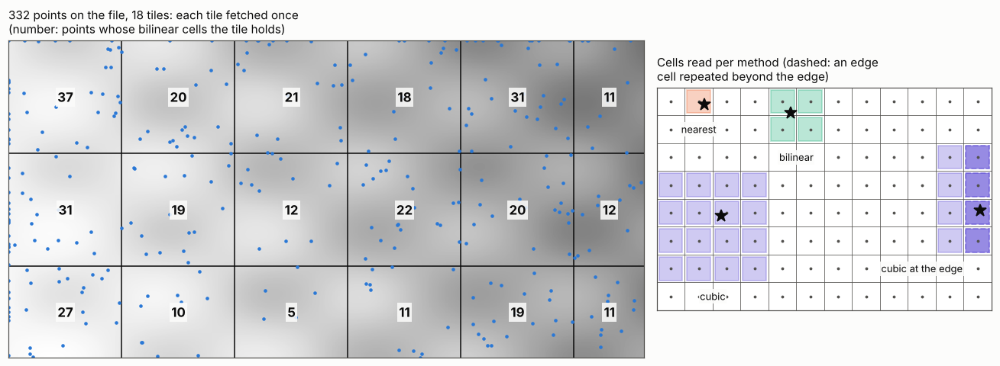

# Values at points: gdallocationinfo and InterpolateAtPoint

Reading a raster at a list of points looks simpler than a warp, and is,
but it has its own rules: which cell a point falls in, what happens at the
edge and around nodata, and how the interpolated reads differ from a
warp's kernels. This page explains GDAL's two point reads, how wxylib
plans them so that each chunk is read once, and how the values are
compared.

The code is `crates/wxy-warp/src/extract.rs` in
[wxylib/core](https://github.com/wxylib/core) and the `wxy points`
command. The GDAL behaviour it ports is `gdallocationinfo` (apps) and
`GDALRasterBand::InterpolateAtPoint`
(`gcore/gdal_interpolateatpoint.cpp`, GDAL 3.10 and later).

## Where a point falls

GDAL finds a point's position in two steps: transform it from its own CRS
to the raster's, then apply the inverse geotransform, giving a fractional
pixel and line (0 at the outer edge of the first cell). For a curvilinear
source the second step is the inverse of the geolocation arrays instead
(see [curvilinear grids](geoloc.md)). A single point is transformed
exactly, without the warper's approximate transformer.

## Nearest: the cell it falls in

`gdallocationinfo` reads the cell the position falls in: the floor of
pixel and line. A point is on the raster when `0 <= pixel < width` and
`0 <= line < height`. The value is returned in the raster's own type,
nodata included (it is up to the caller to compare with the nodata
value).

## Interpolated: InterpolateAtPoint

`InterpolateAtPoint` works on cell centres: it subtracts half a cell from
the position, and puts its kernel on the 2 x 2 (bilinear) or 4 x 4 (cubic,
cubic spline) cell centres around the point. Its rules differ from the
warp kernels' (see [resampling kernels](kernels.md)) in ways that change
the numbers:

- **Edges repeat.** Kernel cells beyond the raster's edge take the value
  of the nearest edge cell. The warper instead drops them and
  renormalises. A point is on the raster up to and including its far
  edge (`pixel <= width`).
- **Nodata.** Bilinear gives no value at all if any of its four cells is
  nodata. Cubic and cubic spline leave nodata cells out of the weights and
  renormalise over the rest, giving no value only if nothing is left.
- **No stretch.** There is no target resolution, so the kernel is always
  1:1.
- **Doubles out.** The result is a 64-bit float, not rounded to the
  raster's type.
- **Small rasters** downgrade the method: cubic becomes bilinear below
  4 x 4 cells, bilinear becomes nearest below 2 x 2.

Cubic is Catmull-Rom, as in the warper; cubic spline is the cubic
B-spline, which smooths rather than interpolates (it does not pass
through the cell values).

## How wxylib plans the reads

GDAL reads points one at a time through its block cache. wxylib plans
them first (`plan_points`):

1. transform all points to source positions, as above;
2. work out which cells each point's kernel needs, with edge cells
   clamped (or wrapped, below);
3. group the points by the chunks (tiles) that hold those cells. A point
   whose kernel crosses a chunk boundary is in each group.

Then each chunk is fetched and decoded once, however many points need it,
and every slice of any leading dimensions (time, depth, band) is read at
the same positions. In the figure, 332 points on the world fixture touch
all 18 of its tiles, so 18 reads serve them all.

One deliberate difference: for a lon/lat source spanning 360 degrees,
wxylib wraps a point's longitude into the source, and lets a kernel at
the left or right edge take cells from the other side rather than repeat
the edge. `--no-wrap` (CLI) or `wrap_globe: false` gives GDAL's behaviour,
where such a point is off the raster.

| GDAL | wxylib (`extract.rs`) |
|------|-------|
| point to pixel and line (`gdallocationinfo`) | `plan_points` (through the warp transformer, exact) |
| pixel and line given directly | `plan_pixels` |
| on-raster tests, method downgrade | `plan_from` |
| `InterpolateAtPoint` (bilinear, cubic, cubic spline) | `interpolate` |
| `CubicKernel`, `CubicSplineKernel` | `cubic`, `cubic_spline` |
| `ARE_REAL_EQUAL` (nodata comparison) | `are_real_equal` |

`wxy points` reads x,y lines on standard input and writes CSV in long
form: `x,y`, the index of each leading dimension, and `value`, one row per
point and slice.

## How the match is tested

[wxylib/fixtures](https://github.com/wxylib/fixtures) `points/`, made by
`scripts/make_point_fixtures.py`: 400 random points over each of five
GeoTIFF fixtures (byte, uint16, int16 and float32 with nodata; one to
three bands), given both in EPSG:4326 and in the file's own CRS, so nine
cases. The nearest values are what `gdallocationinfo` reads. The
interpolated values come from GDAL's own
`GDALRasterInterpolateAtGeolocation`, called through ctypes in the GDAL
that rasterio bundles, along with GDAL's own pixel and line for each
point.

`cargo test -p wxy-warp --test points` checks, for every case:

- **nearest**: which points are on the raster, and every value, identical
  to GDAL's;
- **interpolated**: at GDAL's own pixel and line, every bilinear, cubic
  and cubic spline value identical (no value exactly where GDAL has
  none); from the points themselves, positions within 1e-8 pixels of
  GDAL's, the difference between the pure-Rust proj4rs and PROJ;
- **planning**: no chunk fetched twice, and exactly the chunks the plan
  lists.

The figure is made by [points-figure.py](points-figure.py) from the world
fixture and its point case.
