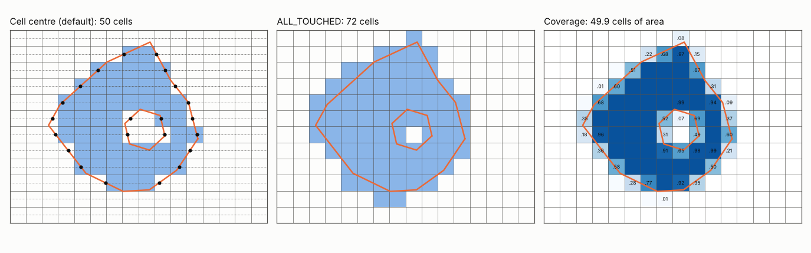

# Polygons to cells: GDAL's rasterizer

Zonal statistics, masks and cutlines all start by asking which cells of a
grid a polygon gets. There are three common answers: the cells whose
centre is inside, every cell the polygon touches, or every cell weighted
by how much of it is covered. This page explains how GDAL's rasterizer
gives the first two, how wxylib ports it without making a raster, and
how the cells are compared with GDAL's.

The code is `crates/wxy-warp/src/rasterize.rs` and `zonal.rs` in
[wxylib/core](https://github.com/wxylib/core). The GDAL code it ports is
`alg/llrasterize.cpp` and the ring handling in `alg/gdalrasterize.cpp`
(GDAL 3.12). For how `wxy zonal` uses the cells, with timings against
GDAL and exactextract, see the [zonal statistics
example](../examples/zonal/README.md).

## Cell centres: the scanline fill

`GDALdllImageFilledPolygon` walks the grid row by row. For each row it
draws a horizontal line through the row's cell centres (`row + 0.5`) and
finds where every edge of every ring crosses it (the dots in the figure).
An edge counts when the line is at or above its lower end and strictly
below its upper end, so a vertex exactly on the line is counted once, not
twice. Each crossing is rounded to a cell boundary with
`floor(x + 0.5)`, the crossings are sorted, and the cells between the
first and second, third and fourth, and so on are burned.

So a cell is in when its centre is inside the polygon, with ties broken
the same way every time. Holes and multi-part polygons need no special
case: a hole's edges add crossings, and the pairing leaves its cells out.
Horizontal edges cross no scanline and are handled apart.

## ALL_TOUCHED: walking the edges

With `ALL_TOUCHED` GDAL burns the scanline fill and, in addition, every
cell each ring passes through (`GDALdllImageLineAllTouched`). It walks each
edge from left to right, cell to cell, stepping to the next column
boundary or the next row boundary, whichever the edge reaches first. An
edge lying exactly on a cell boundary (to within 1e-4 of a cell) touches
neither side, so a rectangle drawn on cell boundaries burns the cells
inside it and no more. Nudges of 1e-9 keep the walk moving when it lands
exactly on a corner.

## Before the burn

Two things happen to the polygon before any cell is burned, and both
change the answer:

- **Rings are wound clockwise.** `gdal_rasterize` rewinds each ring
  clockwise in its own CRS (OGR's `isClockwise`), so the edges reach the
  burn in a fixed order whichever way the input was wound.
- **Vertices are moved one by one.** A polygon in another CRS is
  reprojected vertex by vertex, without adding points along the edges. A
  long edge that is straight in lon/lat stays straight in the grid's CRS,
  where the true line of constant latitude would curve. To follow the
  curve, densify the polygon before burning it.

## Coverage fractions

GDAL's rasterizer has no third rule. wxylib's `--coverage` takes the
exact fraction of each cell the polygon covers, as exactextract does,
from [controlledburn](https://github.com/hypertidy/controlledburn-rs):
whole interior cells, with a fraction for every cell an edge crosses.
Each ring is burned on its own and holes are subtracted. The fractions
sum to the polygon's area in cells, and every cell the centre rule burns
is among them.

## How wxylib does it

GDAL burns into a raster the size of the grid. wxylib keeps the same
arithmetic but records each burn as a row span (row, first column, last
column) and never makes the raster. Its memory is the spans, roughly the
polygon's perimeter in cells plus one span per row. `wxy zonal` groups the
spans by the source chunks they cross and reads each chunk once (see the
[example](../examples/zonal/README.md)).

| GDAL | wxylib |
|------|-------|
| `GDALdllImageFilledPolygon` | `filled_polygon` (`rasterize.rs`) |
| `GDALdllImageLineAllTouched` | `line_all_touched` (`rasterize.rs`) |
| `OGRLineString::isClockwise` | `is_clockwise` (`rasterize.rs`) |
| rings wound and vertices moved (`gdalrasterize.cpp`) | `Burner::gdal` (`zonal.rs`) |
| cells for each polygon alone | `polygon_cells` (`zonal.rs`) |
| (exactextract) coverage | `polygon_coverage`, through controlledburn (`zonal.rs`) |

## How the match is tested

[wxylib/fixtures](https://github.com/wxylib/fixtures) `polygons/`, made
by `scripts/make_polygon_fixtures.py`: 12 random star-shaped polygons
over each of five GeoTIFF fixtures, some with holes and some wound the
other way, given both in EPSG:4326 and in the file's own CRS (nine
cases). For each polygon alone, the cells GDAL burns
(`rasterio.features.rasterize`, which calls `GDALRasterizeGeometries`),
by centre and with `ALL_TOUCHED`.

`cargo test -p wxy-warp --test polygons` requires every polygon's cells,
by both rules, to be exactly GDAL's: no cell extra and none missing, for
all 108 polygons. For coverage it checks that every cell the centre rule
burns is covered, every fraction is in (0, 1], and a polygon inside the
grid covers its own area to within 1e-4 of a cell.

The figure is made by [rasterize-figure.py](rasterize-figure.py), with
GDAL's rasterizer for the first two panels and shapely for the
fractions.
