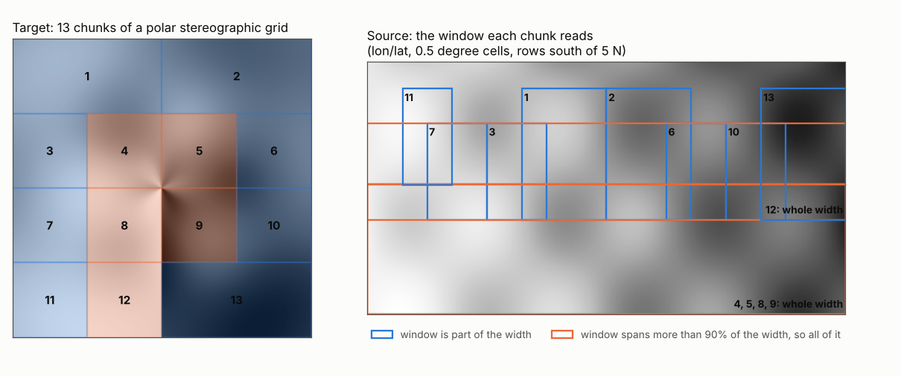

# How the warper works: chunks, windows and kernel scale

A warp fills a target grid with values from a source grid in another
projection: for every target cell, find where its centre lands in the
source and resample there. Written that way it is one loop. GDAL's warper
does more than the loop, and the extra steps decide the numbers it writes.
This page explains those steps, where each one lives in wxylib, and how the
two are kept identical.

The code is `wxy-warp` (`crates/wxy-warp/src/chunked.rs`) and
`wxy-resample` in [wxylib/core](https://github.com/wxylib/core). The GDAL
code it ports is `alg/gdalwarpoperation.cpp` and `alg/gdalwarpkernel.cpp`
(GDAL 3.12).

## The steps in GDAL

1. **The transformer.** Target pixel positions go to source pixel
   positions through the CRS transform, wrapped in GDAL's *approximate*
   transformer. Along each run of points (a scanline, or an edge of a
   window) it transforms the two ends and the middle exactly; if the middle
   is within 0.125 pixels of the straight line between the ends it
   interpolates the rest linearly, otherwise it halves the run and tries
   again. So the result depends on where each run starts and ends.

2. **The chunk list** (`CollectChunkList`). The target is not warped in one
   piece. GDAL computes the source window the whole target needs, and
   splits the target in half, along its longer side, when either

   - the source window plus the target would exceed the warp memory limit
     (64 MB by default), or
   - the window is less than half full of real source cells (the window's
     bounding box runs off the source) and the chunk is more than 100
     cells along either side.

   Each half is then treated the same way, recursively.

3. **The source window of a chunk** (`ComputeSourceWindow`). GDAL
   transforms 21 points along each edge of the chunk back to the source
   and takes their bounding box. If any of those points fail (they fall
   outside the projection's domain), or the target contains a pole, it
   samples a 23 x 23 grid over the chunk instead, and also transforms a
   23 x 23 grid of *source* points forward to catch source cells that land
   inside the chunk but are missed by the backward sample. The box grows by
   the kernel's radius (more when the kernel is stretched, step 4, and by
   10 cells when any point failed), and a window covering more than 90% of
   the source width or height takes all of it.

4. **The kernel scale** (`GDALWarpKernel::PerformWarp`). The ratio of a
   chunk's target size to its source window size says whether the target
   is coarser than the source. If it is (a ratio below 1), bilinear and
   cubic kernels are stretched by that ratio so each target cell averages
   over all the source cells under it, rather than sampling four or
   sixteen of them. A ratio within 0.05 of 1/n snaps to 1/n.

5. **The kernel loop.** For each target cell in the chunk, GDAL transforms
   its centre, checks it lands in the window (retrying with the exact
   transformer for points just outside, `GWKCheckAndComputeSrcOffsets`),
   and resamples with the chunk's scaled kernel. With nodata, invalid
   source cells are skipped and the kernel's weights renormalised; at the
   edge of the projection's domain a valid neighbour stands in for an
   invalid cell (`GWKAdjustSrcOffsetOnEdge`).

## What it looks like

The world fixture (0.5 degree lon/lat) warped to a 2000 x 2000 south polar
stereographic grid, with the memory limit lowered to 1 MB so that the
chunking shows at this size. The target splits into 13 chunks (left); each
reads only its own source window (right). The four chunks around the pole
see every longitude, so their windows take the whole width, as does chunk
12, which straddles the 180 degree meridian (straight down from the pole).



The chunk list is GDAL's (gdalwarp `-wm 1`, through osgeo.gdal), read from
its debug log by [warper-chunks.py](warper-chunks.py). `wxy warp ... --wm 1 --dry-run`
prints wxylib's plan (`warp_chunks`), which has the same 13 chunks and
windows, and the warp itself gives GDAL's values in all 4,000,000 cells
for nearest, bilinear and cubic.

## Why the chunks matter to the values

If the chunks only saved memory, any chunking would do. They also change
the output:

- **Kernel scale** is set per chunk from its window (step 4). A chunk
  whose window is a little wider gets a slightly different stretch, and
  different bilinear and cubic values.
- **Window edges** clip the kernel: a cell near a window edge sees fewer
  source cells than it would in a larger window.
- **Approximation runs** follow chunk rows (step 1), so where the
  transformer interpolates, and where it falls back to exact transforms,
  depends on the chunk's extent.

So matching GDAL cell for cell means planning the same chunks, the same
windows and the same scales, not just using the same kernels.

## How wxylib does it

The port keeps GDAL's steps and their arithmetic order, as plain functions
over a transformer:

| GDAL | wxylib (`wxy-warp`, `chunked.rs` unless noted) |
|------|-------|
| `GDALApproxTransform` | rwarp's `ApproxTransformer`, wrapped in `Approx` (`lib.rs`) |
| `CollectChunkList` | `Planner::chunks` |
| `ComputeSourceWindow` | `Planner::source_window` |
| `ComputeSourceWindowTransformPoints` | `Planner::sample` |
| `ComputeSourceWindowStartingFromSource` | `Planner::probe_source` |
| kernel scale in `PerformWarp` | `chunk_scale`, `Scale::ratios` (`wxy-resample`) |
| `GWKCheckAndComputeSrcOffsets` | `src_offset` |
| `GWKAdjustSrcOffsetOnEdge` | `adjust_on_edge` |
| warp kernels (nearest, bilinear, cubic) | `Kernel::value`, `Kernel::density` (`wxy-resample`) |

Two things are organised differently, without changing the values:

- **Planning is separate from reading.** `WarpPlan` runs the chunk
  planner once, takes the union of the chunk windows, and fetches that
  region as whole source chunks (COG tiles or Zarr chunks). Any leading
  dimensions (time, depth, band) are then warped slice by slice under the
  same plan, so a 4D store streams through without being loaded.
- **The kernels have no I/O and no transforms.** `wxy-resample` takes a
  window of cells and a position in it, and nothing else; the chunk loop
  in `wxy-warp` supplies both (see [the kernels](kernels.md)).

And a few things differ on purpose, each with a switch:

- A source covering 360 degrees of longitude wraps: target cells past its
  edge read the other side, and pole rows are read rather than left empty.
  `--no-wrap` (CLI) gives GDAL's behaviour.
- `--plain` warps in one pass through rwarp with a 1:1 kernel, skipping
  the chunk plan: faster on large targets, but bilinear and cubic then
  sample rather than smooth a coarser target.

Not ported: GDAL's retry with `CHECK_WITH_INVERT_PROJ` for windows with
wild values (a PROJ switch the pure-Rust proj4rs backend does not have),
destination alpha, cutlines, and source masks other than nodata.

## How the match is tested

GDAL is the oracle. [wxylib/fixtures](https://github.com/wxylib/fixtures)
holds small source files and what GDAL's warper writes for them
(`scripts/make_warp_fixtures.py`, through rasterio with the approximate
transformer at its default 0.125 pixel threshold). There are 13 source and
target pairs, each with nearest, bilinear and cubic: global to Antarctic
polar stereographic, polar to lon/lat, a 0 to 360 source across its seam,
a source with nodata, UTM to lon/lat at 1:1 and coarser, and targets that
read from overviews. Two of them split into chunks: `polar-to-4326-global`
into 16, because most of its target misses the source (the fill ratio
rule), and `world-to-3031-wm1` into 4, with the memory limit at 1 MB
(`WarpOptions::memory_limit`, `wxy warp --wm`, gdalwarp's `-wm`).
`cargo test -p wxy-warp` (`tests/gdal_oracle.rs`) warps each and compares
with GDAL's output. The bar is identity: every cell, every case.

Larger splits were checked for this page:

- **The chunk list.** For five target grids (polar stereographic targets
  of four extents from the world fixture, and the polar fixture to
  lon/lat; nearest, bilinear and cubic), wxylib's chunks and windows were
  the same as GDAL's debug log at a 1 MB memory limit, between 8 and 44
  chunks each.
- **The values.** [warper-check.py](warper-check.py) warps the polar
  fixture to a 3000 x 600 lon/lat grid, which GDAL splits into 44 chunks
  at its default settings, with `wxy warp` and with GDAL's
`gdal raster reproject`. All 1,800,000
  cells are identical for nearest, bilinear and cubic.

```
near     GDAL chunks:  44  cells differing: 0 of 1800000
bilinear GDAL chunks:  44  cells differing: 0 of 1800000
cubic    GDAL chunks:  44  cells differing: 0 of 1800000
```
