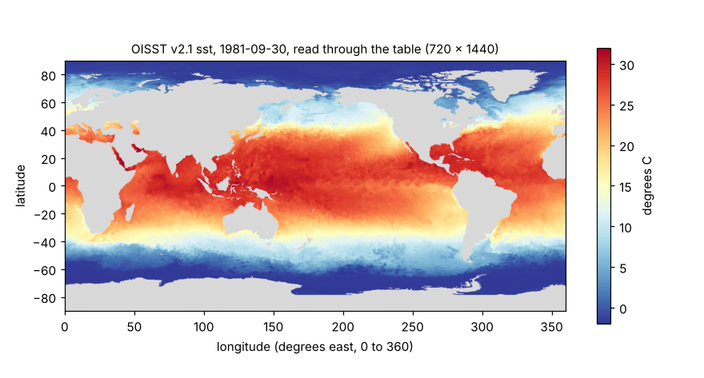
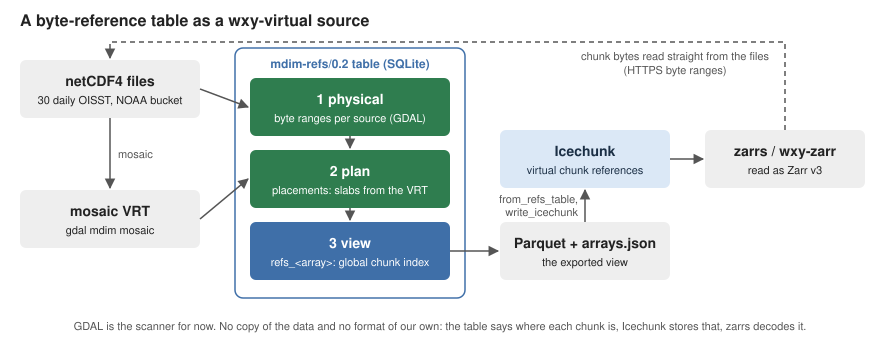

# Walk-through: a month of OISST as virtual Zarr

This walk-through reads 30 days of real sea surface temperature from NOAA's
public bucket without copying any of it. A small table says where every
chunk of every file is; wxylib turns that table into an Icechunk repository
of virtual references, and reads it back as ordinary Zarr. At each step the
result is checked against GDAL reading the original files.

It uses `wxy-virtual` (`from_refs_table`), `wxy-zarr` and `wxy-warp` from
[wxylib/core](https://github.com/wxylib/core), and a table built by a
script in [wxylib/fixtures](https://github.com/wxylib/fixtures).

## 1. The data

NOAA OISST v2.1 is one netCDF4 file per day since September 1981: a quarter
degree global grid (720 x 1440) of four int16 arrays, `sst`, `anom`, `err`
and `ice`, each stored as a single compressed chunk (shuffle, then
deflate). Each array is 4D, `(time, zlev, lat, lon)`, with time and zlev of
length 1 per file. Latitude runs south to north and longitude 0 to 360.



Thirty files make one array of shape `[30, 1, 720, 1440]` with chunks
`[1, 1, 720, 1440]`: one chunk per file.

## 2. The table

The table is an [mdim-refs/0.2](https://github.com/wxylib/design/blob/main/specs/mdim-refs-0.2.md)
byte-reference table. It is not a wxylib format. It comes from adjacent
work (hypertidy/zaro reads it too), and wxylib uses it as one more source.



It holds three layers, each once:

1. **Physical.** For each source file and array, the byte offset and size
   of every chunk, keyed by the chunk's position within that file. GDAL
   reports these (`MDArray.GetRawBlockInfo`). It is the scanner for
   netCDF4 until a Rust one exists.
2. **Plan.** Where each file's slab sits in the whole array, copied from
   the `<Source>` elements of a `gdal mdim mosaic` VRT, so the table no
   longer needs the VRT.
3. **View.** `refs_<array>`, one row per chunk of the whole array:
   `dim_0 .. dim_3, present, path, offset, size, info`.

Three rows of `refs_sst` for September 1981 (path shortened):

```
dim_0  present  path                                       offset   size
0      1        /vsicurl/https://noaa-cdr-.../19810901.nc  1025881  683590
1      1        /vsicurl/https://noaa-cdr-.../19810902.nc  1031813  684863
29     1        /vsicurl/https://noaa-cdr-.../19810930.nc  1019841  672468
```

An `arrays` table beside it holds each array's dims, shape, chunks, numpy
dtype (`<i2`), fill value (-999), codecs as Zarr v2 ids
(`shuffle` then `zlib`), CF attributes, and coordinates: `lat` and `lon`
as `{start, step}`, `time` and `zlev` as inline values. A `remap` table
rewrites the recorded paths when the table is published: here the
`public` target turns `/vsicurl/https://` into plain `https://`.

The 30-day table is 90 KB as SQLite. wxylib reads its export: one
`refs_<array>.parquet` per array plus `arrays.json` (22 KB in all).

### Building it

With GDAL 3.12 or later (Python bindings and the netCDF driver), netCDF4,
numpy and pyarrow:

```sh
git clone https://github.com/wxylib/fixtures
cd fixtures
micromamba create -n wxy -c conda-forge "gdal>=3.12" libgdal-netcdf netcdf4 numpy pyarrow
micromamba run -n wxy python scripts/make_mdimrefs_oisst_198109.py
```

This takes about half a minute, most of it reading file headers over HTTP.
The result, already in the repository, is `mdimrefs/oisst-198109/`.

## 3. Reading it in Rust

```rust
use wxy_source::{read_window, Window};

// The table, with paths remapped to https://
let arrays = wxy_virtual::from_refs_table("mdimrefs/oisst-198109", Some("public"))?;

// Into a local Icechunk repository as virtual references, then back out
// as zarrs storage. No chunk data is copied.
wxy_virtual::write_icechunk("oisst.icechunk", &arrays).await?;
let storage =
    wxy_virtual::open_icechunk("oisst.icechunk", &wxy_virtual::prefixes(&arrays)).await?;

// Day 30 of sst: one chunk, fetched from NOAA by byte range.
let sst = wxy_zarr::open(storage, "sst").await?;
let day30 = read_window(&sst.source, &Window::new(vec![29, 0, 0, 0], vec![1, 1, 720, 1440])).await?;
```

What `from_refs_table` does with the table:

- Codecs become Zarr v3: `bytes` (little endian), `numcodecs.shuffle`
  (element size 2), `numcodecs.zlib`. zarrs decodes them.
- `lat` and `lon` become GeoZarr `spatial:` attributes (a transform placing
  cell corners: x from 0 by 0.25, y from -90 by 0.25) and `proj:code`
  EPSG:4326. That CRS is an assumption, since CF latitude and longitude
  name no datum. `time` stays a CF coordinate array.
- Rows with `present = 1` become chunk references; absent rows read as the
  fill value.

The whole thing runs as an example in core:

```sh
git clone https://github.com/wxylib/core
git clone https://github.com/wxylib/fixtures
cd core
cargo run -p wxy-virtual --example oisst_refs -- ../fixtures/mdimrefs/oisst-198109
```

```
8 arrays, chunk containers ["https://noaa-cdr-sea-surface-temp-optimum-interpolation-pds.s3.amazonaws.com/"]
sst: day 30 identical to GDAL (0.73 s)
anom: day 30 identical to GDAL (0.29 s)
err: day 30 identical to GDAL (0.20 s)
ice: day 30 identical to GDAL (0.19 s)
```

"Identical" means the SHA-256 of the bytes read matches the hash in
`manifest.json`, which the fixtures script took from GDAL reading the
original netCDF file.

## 4. Warping day 30 to the Antarctic

Give the example a second argument and it also warps day 30 `sst` to
Antarctic polar stereographic (EPSG:3031): 400 x 400 cells of 20 km,
nearest neighbour, from -4000 to 4000 km in x and y.

```sh
cargo run -p wxy-virtual --example oisst_refs -- ../fixtures/mdimrefs/oisst-198109 sst-3031.bin
```


The comparison is with

```sh
gdalwarp -s_srs EPSG:4326 -t_srs EPSG:3031 -te -4e6 -4e6 4e6 4e6 -ts 400 400 -r near \
  NETCDF:"/vsicurl/https://noaa-cdr-sea-surface-temp-optimum-interpolation-pds.s3.amazonaws.com/data/v2.1/avhrr/198109/oisst-avhrr-v02r01.19810930.nc":sst out.tif
```

159,921 of 160,000 cells are identical. The 79 that differ lie along the
x = 0 line, where target longitudes are near 0 and 180 degrees, and each
takes a neighbouring source cell. That seam is an open wxy-warp question.

The source here is 0 to 360 degrees east, and the target needs longitudes
west of 0 too. wxy-warp recognises the grid as global and wraps it.

## What this shows, and what it does not

- **Shown:** a flat table of chunk references is enough to read a real
  archive as Zarr, with Icechunk as the place the references are stored.
  This is the design's open "table first" question (design doc 03; the
  pilot is [m02](https://github.com/wxylib/design/blob/main/docs/m02-pilot-mdimrefs.md)),
  tried on real data.
- **Not yet:** `s3://` references (a public bucket works through an
  `https://` remap); arrays with several chunks per file; a Rust scanner
  for netCDF4 (GDAL does the scanning); R and Python bindings.
- **A GDAL quirk** found on the way: in GDAL 3.13 `GetRawBlockInfo` raises
  an error for a chunk that was never written, instead of reporting it as
  absent. The fixtures script treats a block as absent only when GDAL reads
  it as all fill.

The small test version of this table (three synthetic days, one chunk
missing on purpose) is `fixtures/mdimrefs/`, and the core test
`virtual_mdimrefs_matches_gdal` checks it byte for byte on every pull
request.
